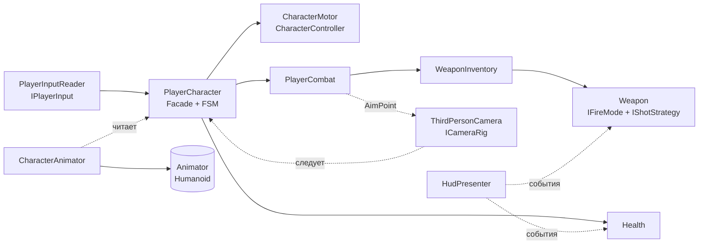
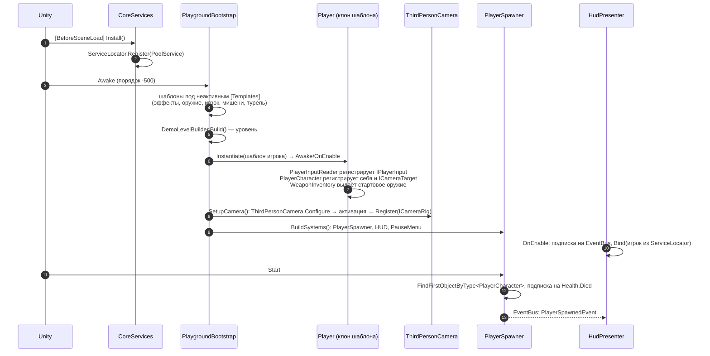
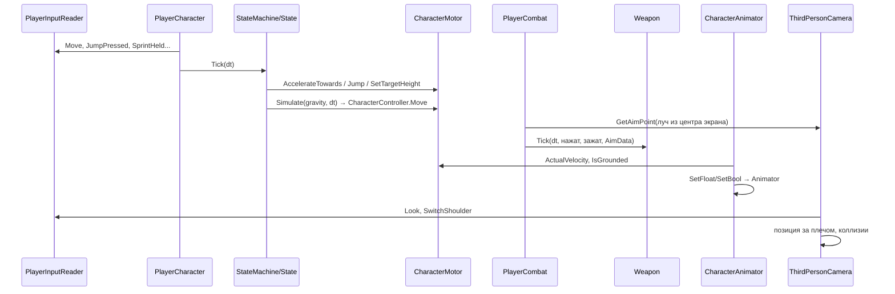
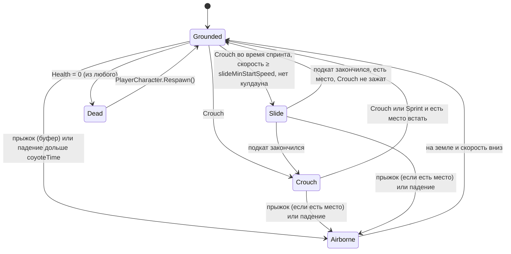
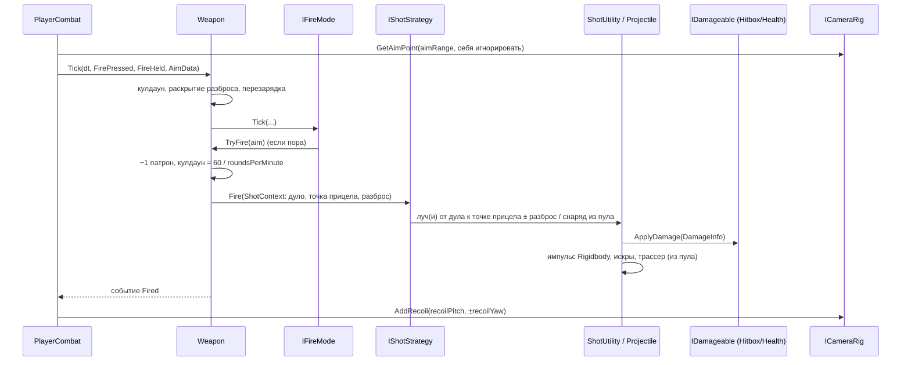
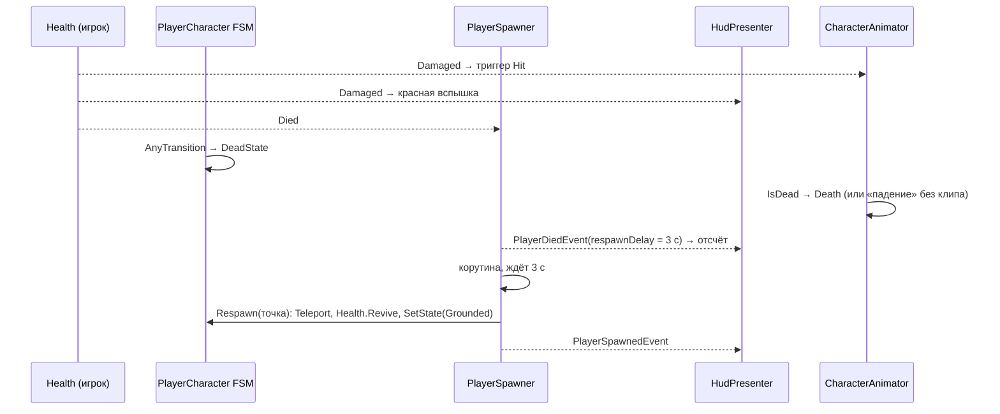
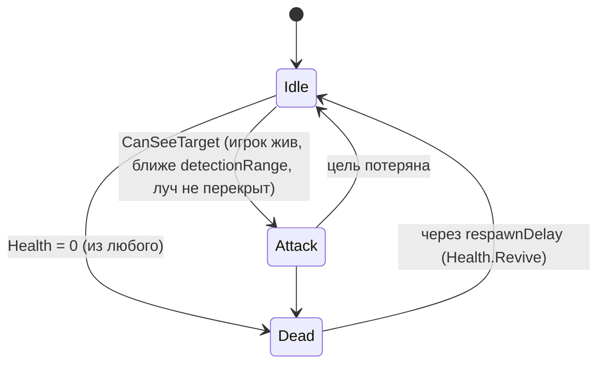

# Архитектура TPS Skeleton

Документ объясняет, **как устроен и как работает** код игры: из каких частей он состоит, кто кого вызывает,
в каком порядке, через какие интерфейсы и события. Описание каждого класса и члена — в [API.md](API.md),
диаграммы классов — в [UML.md](UML.md), установка и управление — в [README.md](README.md).

## Содержание

1. [Обзор](#1-обзор)
2. [Структура проекта и сборки](#2-структура-проекта-и-сборки)
3. [Пакеты и зависимости](#3-пакеты-и-зависимости)
4. [Запуск игры](#4-запуск-игры)
5. [Кадр игры и порядок выполнения](#5-кадр-игры-и-порядок-выполнения)
6. [Ввод](#6-ввод)
7. [Передвижение персонажа](#7-передвижение-персонажа)
8. [Камера от третьего лица](#8-камера-от-третьего-лица)
9. [Оружие и стрельба](#9-оружие-и-стрельба)
10. [Урон, смерть и возрождение](#10-урон-смерть-и-возрождение)
11. [Анимации и скелет Mixamo](#11-анимации-и-скелет-mixamo)
12. [ИИ: турель и мишени](#12-ии-турель-и-мишени)
13. [Предметы и объекты уровня](#13-предметы-и-объекты-уровня)
14. [Интерфейс: HUD и пауза](#14-интерфейс-hud-и-пауза)
15. [Инфраструктура: сервисы, события, пулы](#15-инфраструктура-сервисы-события-пулы)
16. [Демо-контент: сцена Playground и генератор](#16-демо-контент-сцена-playground-и-генератор)
17. [Паттерны проектирования](#17-паттерны-проектирования)
18. [Как расширять](#18-как-расширять)
19. [Соглашения и документация](#19-соглашения-и-документация)
20. [Ограничения и что можно улучшить](#20-ограничения-и-что-можно-улучшить)

---

## 1. Обзор

Скелет шутера от третьего лица на Unity 6 (URP, Input System). Цели архитектуры:

- **Заменяемость.** Геймплей зависит от интерфейсов (`IPlayerInput`, `ICameraRig`, `IDamageable`, `IHudView`,
  `IFireMode`, `IShotStrategy`), а не от конкретных систем Unity. Ввод, HUD, оружие и анимации меняются независимо.
- **Данные отдельно от кода.** Цифры баланса лежат в ScriptableObject (`MovementConfig`, `CameraConfig`,
  `WeaponDefinition`, `AnimationSet`). Новое оружие — новый ассет, без программирования.
- **Явная логика состояний.** Движение игрока и ИИ — конечные автоматы (`StateMachine`) с переходами в одном месте.
- **Слабая связанность.** Системы общаются через события (`EventBus` и C#-события) и находят друг друга
  через `ServiceLocator`, без `FindObjectOfType` и жёстких ссылок.
- **Всё из примитивов.** Модели строятся кодом. Анимации — Humanoid-клипы Mixamo, которые проигрываются
  на «манекене» со скелетом Mixamo.

Главный объект — **`PlayerCharacter`** (Facade). Вокруг него собраны мотор, бой, здоровье, ввод и анимации:



## 2. Структура проекта и сборки

```
Prod/
├─ Assets/
│  ├─ Game/
│  │  ├─ Scripts/
│  │  │  ├─ Runtime/      сборка Game.Runtime (вся игра)
│  │  │  └─ Editor/       сборка Game.Editor (только редактор: генератор демо, инспекторы)
│  │  ├─ Scenes/Playground.unity      готовая сцена (собирается в игре)
│  │  ├─ Animation/                   PlaygroundAnimator.controller, PlaygroundAnimationSet.asset
│  │  └─ Generated/                   создаётся генератором (Tools → TPS Skeleton)
│  ├─ Models/                         клипы Mixamo (Idle_, Jogging)
│  ├─ InputSystem_Actions.inputactions
│  └─ _Legacy/                        первоначальный набросок (не используется)
├─ Docs/                              документация и генераторы документации
└─ Prod_di.drawio                     UML для draw.io
```

| Сборка | Где | Зависит от | Содержимое |
|---|---|---|---|
| `Game.Runtime` | `Scripts/Runtime` | `Unity.InputSystem` | Весь игровой код: пространства имён `Game.*` |
| `Game.Editor` | `Scripts/Editor` | `Game.Runtime` (только Editor) | Меню Tools → TPS Skeleton, генератор ассетов, инспектор AnimationSet |

Пространства имён названы так, чтобы не совпадать с типами Unity: `Game.Cameras`, `Game.Inputs`, `Game.Animations`.

## 3. Пакеты и зависимости


| Пакет | Namespace | Назначение | Ключевые классы |
|---|---|---|---|
| Core | `Game.Core` | Инфраструктура, не знает о геймплее | `ServiceLocator`, `EventBus`, `StateMachine`, `PoolService`, `PhysicsQuery` |
| Inputs | `Game.Inputs` | Ввод | `IPlayerInput`, `PlayerInputReader` |
| Character | `Game.Character` | Игрок | `PlayerCharacter`, `CharacterMotor`, `PlayerCombat`, `MovementConfig` |
| Character.States | `Game.Character.States` | Состояния движения | `CharacterState` и 5 состояний |
| Cameras | `Game.Cameras` | Камера | `ThirdPersonCamera`, `ICameraRig`, `ICameraTarget`, `CameraConfig` |
| Animations | `Game.Animations` | Связь с Animator | `CharacterAnimator`, `AnimationSet`, `AimIKHandler`, `AnimatorParams` |
| Combat | `Game.Combat` | Урон и снаряды | `Health`, `Hitbox`, `IDamageable`, `Projectile`, `Explosion` |
| Combat.Weapons | `Game.Combat.Weapons` | Оружие | `Weapon`, `WeaponDefinition`, `WeaponFactory`, режимы огня и выстрелы |
| AI | `Game.AI` | Враги | `EnemyTurret` (+ состояния), `TargetDummy` |
| Interaction | `Game.Interaction` | Предметы уровня | `Pickup`, `HealthPickup`, `AmmoPickup`, `JumpPad` |
| Gameplay | `Game.Gameplay` | Правила | `PlayerSpawner` |
| UI | `Game.UI` | Интерфейс | `IHudView`, `HudPresenter`, `ImGuiHudView`, `PauseMenu` |
| Demo | `Game.Demo` | Демо-контент из примитивов | `PlaygroundBootstrap`, `DemoContentFactory`, `DemoLevelBuilder`, `MannequinBuilder` |
| EditorTools | `Game.EditorTools` | Генератор (редактор) | `TpsSkeletonMenu`, билдеры ассетов |

Правило направления: **Core ни от кого не зависит**, Character зависит от Core/Inputs/Cameras/Combat.
Animations, UI и AI читают Character, но Character о них не знает. Demo знает обо всех: это сборщик.

## 4. Запуск игры



**Приём «настройка до Awake».** Компоненты, создаваемые кодом, получают параметры через `Configure(...)`.
Чтобы `Awake` увидел уже заданные значения, объект строится внутри **неактивного** родителя (`Primitives.Inactive`)
или временно выключается. Шаблоны лежат в неактивном `[Templates]`: их компоненты не работают и служат
«префабами в памяти». `Instantiate` создаёт активную копию, и та запускается уже настроенной.

## 5. Кадр игры и порядок выполнения

Порядок задан атрибутом `[DefaultExecutionOrder]`, чтобы данные текли в одну сторону без задержек в кадр:

| Порядок | Компонент | Метод | Что делает |
|---|---|---|---|
| -500 | `PlaygroundBootstrap` | Awake | Строит сцену (один раз) |
| -100 | `PlayerInputReader` | — | Читает Input System по запросу (свойства) |
| 0 | `PlayerCharacter` | Update | Буфер прыжка → вычисление спринта → `StateMachine.Tick` → состояние → `CharacterMotor.Simulate` |
| 10 | `PlayerCombat` | Update | Прицел, смена оружия, перезарядка, точка прицела от камеры, `Weapon.Tick` |
| 50 | `CharacterAnimator` | Update | Скорость/состояние → параметры Animator, вес слоя UpperBody |
| — | Animator | (внутри Unity) | Анимация, затем `AimIKHandler.OnAnimatorIK` |
| 100 | `ThirdPersonCamera` | LateUpdate | Поворот, отдача, следование, коллизии, FOV |
| 200 | `WeaponSocket` | LateUpdate | Поворот оружия к точке прицела после анимации |
| 0 | `HudPresenter`, `PauseMenu`, ИИ, предметы | Update | Обновление интерфейса, логика объектов |
| — | `ImGuiHudView` | OnGUI | Отрисовка HUD |



Камера обновляется последней, поэтому персонаж в кадре N использует направление камеры из кадра N-1.
Это общепринятая задержка в один кадр, на глаз она не видна.

## 6. Ввод

`PlayerInputReader` (паттерн **Adapter**) превращает `InputActionAsset` в интерфейс `IPlayerInput`.
Если ассет не задан, используется project-wide `InputSystem.actions` (это `Assets/InputSystem_Actions.inputactions`).
Имена действий записаны строками только в `InputActionNames`.

| Действие | Клавиатура/мышь | Геймпад | Свойство `IPlayerInput` |
|---|---|---|---|
| Move | WASD / стрелки | левый стик | `Move` |
| Look | мышь (дельта) | правый стик | `Look`, `LookIsDelta` |
| Jump | Space | A | `JumpPressed` |
| Sprint | Left Shift | L3 | `SprintHeld` |
| Crouch | C, Left Ctrl | B | `CrouchPressed`, `CrouchHeld` |
| Attack | ЛКМ | RT | `FirePressed`, `FireHeld` |
| Aim | ПКМ | LT | `AimHeld` |
| Reload | R | X | `ReloadPressed` |
| Interact | E (удержание) | Y | `InteractPressed` |
| Next / Previous | колесо мыши | D-pad →/← | `NextWeaponPressed`, `PreviousWeaponPressed` |
| Weapon1–4 | 1–4 | — | `WeaponSlotPressed` (0..3 или -1) |
| SwitchShoulder | V | R3 | `SwitchShoulderPressed` |
| Pause | Esc | Start | `PausePressed` |

- `Pressed` — нажато в этом кадре (`WasPressedThisFrame`), `Held` — удерживается (`IsPressed`).
- `LookIsDelta` сообщает камере, что пришло: пиксели мыши за кадр (без `deltaTime`) или отклонение стика (× `deltaTime`).
- `GameplayEnabled = false` (пауза) обнуляет весь ввод, кроме `PausePressed`.

Чтобы управлять персонажем без клавиатуры (бот, реплей, сеть), реализуйте `IPlayerInput` и повесьте компонент
на игрока вместо `PlayerInputReader`.

## 7. Передвижение персонажа

### 7.1 Мотор

`CharacterMotor` — низкий уровень поверх `CharacterController`. Он не знает о вводе и состояниях:

- хранит скорость `Velocity` и считает фактическую `ActualVelocity` (после столкновений — для анимаций);
- `Simulate(gravity, dt)`: на земле прижимает к поверхности (`groundStickVelocity = -2`), в воздухе добавляет
  гравитацию (предел `maxFallSpeed`), двигает контроллер, обнуляет скорость вверх при ударе о потолок,
  обновляет `IsGrounded`, `AirTime` и вызывает `Landed`;
- `Jump(height, gravity)` задаёт скорость `v = √(2·h·|g|)` и на 0.1 с запрещает считать персонажа на земле;
- `SetTargetHeight` плавно меняет рост капсулы (пол остаётся на месте) и не растёт, если `CanStandUp` упирается в потолок;
- `CanStandUp(h)` — сферокаст вверх, игнорирующий собственные коллайдеры (`PhysicsQuery`).

### 7.2 Состояния (паттерн State)

`PlayerCharacter.BuildStateMachine()` создаёт 5 состояний и все переходы. Каждое состояние наследует
`CharacterState` (паттерн Template Method): `Tick()` = `OnTick()` состояния + `Motor.Simulate()`.



| Состояние | Скорость | Рост капсулы | Особенности |
|---|---|---|---|
| `GroundedState` | `walkSpeed` при прицеливании, `sprintSpeed` при спринте, иначе `runSpeed` | `standHeight` | Восстанавливает прыжки в воздухе; имя в HUD — Grounded/Sprint |
| `CrouchState` | `crouchSpeed` | `crouchHeight` | Переключается нажатием |
| `SlideState` | старт `max(slideStartSpeed, текущая)`, торможение `slideFriction` | `crouchHeight` (вдвое быстрее) | Лёгкое подруливание `slideSteering`; длится до `slideMaxDuration`; после — кулдаун `slideCooldown` |
| `AirborneState` | сохраняет набранную скорость, управление `airAcceleration` | без изменений | Прыжок при входе по нажатию; двойной прыжок (`maxAirJumps`); имя — Jump/Fall |
| `DeadState` | плавная остановка | без изменений | Ввод игнорируется |

Детали «отзывчивого» управления:

- **Буфер прыжка** (`jumpBufferTime`): нажатие за 0.15 с до приземления не теряется.
- **Coyote time** (`coyoteTime`): 0.12 с после схода с края персонаж ещё в `Grounded` и может прыгнуть с земли.
- **Спринт** (`IsSprinting`) — только в `Grounded`, при зажатом Shift, есть движение, не целится и не стреляет.
- **Поворот** (`UpdateFacing`): в бою (прицел или выстрел за последние 0.6 с) персонаж разворачивается к взгляду
  камеры (стрейф, ×`combatTurnMultiplier`), иначе — по направлению движения.
- **Движение относительно камеры** (`GetMoveDirection`): ввод поворачивается на `ICameraRig.YawRotation`.

## 8. Камера от третьего лица

`ThirdPersonCamera` (реализует `ICameraRig`) висит на Main Camera. Алгоритм `LateUpdate`:

1. Найти цель (`ICameraTarget` из `ServiceLocator`) и ввод.
2. Поворот: `yaw += Look.x · чувствительность`, `pitch -= Look.y · …` (зажим `minPitch..maxPitch`); при
   прицеливании чувствительность × `aimSensitivityMultiplier`. `SwitchShoulder` меняет сторону плеча.
3. Отдача: `AddRecoil` копит «долг», который выплачивается со скоростью `recoilKickSpeed` и затем
   возвращается со скоростью `recoilRecovery`.
4. Плавный переход прицела (`aimBlend`): дистанция, смещение плеча и FOV интерполируются между обычными и прицельными.
5. Точка вращения: `ICameraTarget.PivotPosition` (90% роста капсулы — при приседе камера опускается) со сглаживанием `SmoothDamp`.
6. Коллизии: сферокаст от точки вращения к желаемой позиции, игнорируя игрока. К стене камера прижимается
   мгновенно, а отдаляется плавно (`distanceRecoverSpeed`).
7. `GetAimPoint` — луч из центра экрана (игнорируя стрелка): по нему стреляет оружие.

## 9. Оружие и стрельба

### 9.1 Из чего состоит оружие

```
WeaponDefinition (ScriptableObject, данные)        ← Flyweight: один ассет на всех владельцев
        │  WeaponFactory.Create()                  ← Factory: выбирает стратегии по enum-ам
        ▼
Weapon (обычный C#-класс, состояние экземпляра) ── WeaponView (MonoBehaviour: модель, дуло, вспышка)
   ├─ IFireMode      КОГДА стрелять:  SemiAuto | FullAuto | Burst        ← Strategy
   └─ IShotStrategy  ЧТО происходит:  Hitscan | Spread | Projectile     ← Strategy
```

Комбинируя `fireMode` и `shotType` в ассете, без кода получаем: полуавтоматический дробовик,
очередь из гранатомёта, автоматическую винтовку и т.д.

### 9.2 Поток выстрела



Выстрел летит **от дула к точке под прицелом камеры**. Так пули попадают туда, куда смотрит прицел,
и не проходят сквозь стену перед стволом.

### 9.3 Разброс

```
разброс = (IsAiming ? aimSpread : hipSpread) + раскрытие            ← Weapon.CurrentSpread
раскрытие += spreadPerShot за выстрел (не больше maxBloom), уменьшается на spreadRecovery в секунду
итог     = разброс × множитель движения                              ← AimData.SpreadMultiplier
множитель = Lerp(1, movingSpreadMultiplier, скорость / runSpeed) × (в воздухе ? 2.5 : 1) × (присед ? 0.7 : 1)
```

Прицел HUD переводит угол разброса в пиксели по текущему FOV камеры, поэтому круг на экране соответствует
реальному конусу попаданий.

### 9.4 Режимы огня

| Режим | Поведение |
|---|---|
| `SemiAutoFireMode` | Выстрел на нажатие; нажатие во время кулдауна запоминается на 0.15 с |
| `FullAutoFireMode` | Стреляет, пока зажат курок; щелчок пустого магазина — один раз на нажатие |
| `BurstFireMode` | Очередь из `burstCount` выстрелов, затем пауза `burstCooldown` |

Пустой магазин: `TryFire` проигрывает `emptySound`, вызывает `DryFired` и (если `autoReloadWhenEmpty`) начинает перезарядку.
Перезарядка длится `reloadTime` и переносит патроны из запаса (`InfiniteReserve` у ИИ — без расхода).

### 9.5 Демо-оружие

| Оружие | Режим | Выстрел | Урон | Темп | Магазин |
|---|---|---|---|---|---|
| Pistol | SemiAuto | Hitscan | 25 | 420/мин | 12 |
| Assault Rifle | FullAuto | Hitscan | 16 | 650/мин | 30 |
| Shotgun | SemiAuto | Spread ×9 | 11 × 9 | 75/мин | 6 |
| Grenade Launcher | SemiAuto | Projectile (взрыв R=4) | 100 | 60/мин | 4 |
| Turret Rifle (ИИ) | Burst ×4 | Hitscan | 6 | 600/мин | 30 (∞) |

Цифры — в `DemoWeaponCatalog` (для Playground) или в ассетах `Generated/Weapons` (для генератора).

### 9.6 Положение оружия

`WeaponSocket` прикреплён к кости груди (`mixamorig:Spine2`) и работает после анимации (LateUpdate, порядок 200).
В бою (`IAimProvider.IsCombatReady`) он поворачивает ствол к точке прицела, вне боя держит оружие «по-походному» (`restEulerAngles`).
`WeaponInventory` хранит до `maxWeapons` экземпляров. Неактивное оружие спрятано (`Holster`), при смене перезарядка прерывается.

## 10. Урон, смерть и возрождение

- `IDamageable` реализуют `Health` (здоровье объекта) и `Hitbox` (Proxy: умножает урон и передаёт в `Health` родителя).
  Голова мишени — `Hitbox ×2, critical`.
- Попадание ищет `IDamageable` в родителях коллайдера (`GetComponentInParent`), поэтому хитбоксы и корпус работают без настроек слоёв.
- `Explosion.Detonate` собирает объекты в радиусе, убирает дубли по `DamageRoot` (один объект с несколькими хитбоксами
  получает урон один раз), даёт урон с затуханием к краю и толкает физические тела.
- `Health.ApplyDamage` → события `Damaged`, `Changed`, (`Died`) + глобальное `DamageDealtEvent`.
  Регенерация начинается через `regenDelay` после последнего урона (у игрока: 4 с, 12 HP/с).



## 11. Анимации и скелет Mixamo

### 11.1 Как устроено

```
AnimationSet (ScriptableObject)  ──Rebuild──▶  Animator Controller  ──▶  Animator (на модели "Visual")
   клипы Mixamo по слотам                         параметры AnimatorParams           ▲
                                                                                      │ параметры
                     PlayerCharacter, PlayerCombat, Health ──▶ CharacterAnimator ─────┘  (Adapter)
```

- **Скелет.** `MannequinBuilder` строит иерархию костей с именами Mixamo (`mixamorig:Hips`, `Spine`, `Spine1`,
  `Spine2`, `Neck`, `Head`, `LeftArm`…) в T-позе, крепит к костям примитивы и создаёт Humanoid Avatar
  (`AvatarBuilder.BuildHumanAvatar`). Благодаря Humanoid-ретаргетингу на манекене играет любой Humanoid-клип.
- **Модель отделена от логики.** Animator висит на дочернем объекте `Visual`, логика — на корне. Модель можно заменить
  на настоящую Mixamo-модель (Rig = Humanoid), не трогая код.
- **AnimationSet** хранит клипы по слотам (`AnimationSlot`), пороги скоростей и ссылку на контроллер.
  Пустой слот заменяется ближайшим клипом из цепочки `AnimationSet.Fallbacks` (например, WalkLeft → WalkForward → RunForward).
  Если в замену попал клип другой скорости, контроллер подстраивает его `timeScale`.
- **Контроллер.** В Playground используется готовый `PlaygroundAnimator.controller` (Idle/Jogging по `Speed`).
  Кнопка **Rebuild Animator Controller** в инспекторе AnimationSet (`AnimatorControllerBuilder`) собирает полный контроллер:

| Слой | Состояния | Переходы |
|---|---|---|
| Base Layer (IK Pass) | Locomotion (2D blend `MoveX`/`MoveZ`: Idle, Walk×4, Run×4, Sprint), CrouchLocomotion (2D), Slide, Jump, Fall, Death | `IsCrouching`, `IsSliding`, `IsGrounded`; Any → Jump по `Jump`; Any → Death по `IsDead` |
| UpperBody (маска верха тела, вес из кода) | Empty, Aim, Fire, Reload, Hit | `IsAiming`; Any → Fire/Reload/Hit по триггерам |

### 11.2 Параметры Animator (`AnimatorParams`)

| Параметр | Тип | Откуда |
|---|---|---|
| `MoveX`, `MoveZ` | float | `CharacterMotor.ActualVelocity` в локальных осях персонажа (м/с) |
| `Speed` | float | горизонтальная скорость |
| `VerticalSpeed` | float | вертикальная скорость |
| `IsGrounded` | bool | на земле (короткие отрывы < 0.15 с при спуске не считаются) |
| `IsCrouching`, `IsSliding` | bool | состояние FSM |
| `IsAiming` | bool | оружие поднято: прицел или недавний выстрел |
| `IsDead` | bool | `Health` |
| `Jump`, `Fire`, `Reload`, `Hit` | trigger | события `PlayerCharacter.Jumped`, `PlayerCombat.WeaponFired/ReloadStarted`, `Health.Damaged` |

`CharacterAnimator` проверяет наличие параметра перед установкой. Свой контроллер без каких-то параметров не вызовет ошибок.
Вес слоя UpperBody плавно поднимается, только если для текущего действия есть клип.

**Процедурные заглушки** (пока нет клипов): без клипа приседа модель сплющивается по росту капсулы,
без клипа смерти — падает на спину. **IK взгляда** (`AimIKHandler`): голова и корпус поворачиваются к точке
прицела (в бою — полностью, вне боя — частично).

## 12. ИИ: турель и мишени

`EnemyTurret` переиспользует системы игрока: тот же `StateMachine`, то же оружие через `WeaponFactory`, тот же `Health`.



- **Idle** — вращение `idleScanSpeed`, курок отпущен.
- **Attack** — 0.4 с реакции, затем циклы «0.8 с огонь / 0.7 с пауза». Стреляет, только если ствол отклонён от цели меньше
  `fireAngleTolerance`. Разброс увеличен (`extraSpread`), чтобы турель не была снайпером.
- **Dead** — скрыты рендеры и коллайдеры, восстановление через `respawnDelay` (6 с).

`TargetDummy` — мишень: вспышка `MaterialPropertyBlock` при попадании, исчезает при смерти и возвращается через 3 с.

## 13. Предметы и объекты уровня

- `Pickup` (Template Method): триггер → `TryApply(player)` → спрятать визуал → появиться через `respawnTime`.
  Визуал вращается и покачивается. Наследники: `HealthPickup` (лечит, если HP не полное), `AmmoPickup` (магазины всему оружию).
- `JumpPad` — триггер, вызывает `PlayerCharacter.Launch(скорость)` и восстанавливает прыжки в воздухе.

## 14. Интерфейс: HUD и пауза

HUD сделан по **MVP**:

- **Model** — `PlayerCharacter`, `Health`, `Weapon`, глобальные события.
- **Presenter** — `HudPresenter`: подписывается на `Health.Changed/Damaged`, `WeaponInventory.WeaponEquipped`, `Weapon.AmmoChanged`,
  `EventBus` (`PlayerSpawnedEvent`, `PlayerDiedEvent`, `DamageDealtEvent`). Непрерывные значения (разброс, прогресс
  перезарядки, отладка) обновляет каждый кадр.
- **View** — `IHudView`, реализация `ImGuiHudView` (OnGUI): прицел, хит-маркер (красный — убийство), полоса HP,
  патроны, полоса перезарядки, красная вспышка, отсчёт возрождения, подсказка по управлению.

Заменить IMGUI на uGUI/TextMeshPro = написать новый `IHudView` и поставить его на объект HUD вместо `ImGuiHudView`.

`PauseMenu`: по `Pause` ставит `Time.timeScale = 0`, выключает `IPlayerInput.GameplayEnabled`, освобождает курсор и
публикует `GamePausedEvent`. Меню: Продолжить / Перезапустить сцену / Выход. Курсор снова захватывается кликом.

## 15. Инфраструктура: сервисы, события, пулы

### 15.1 ServiceLocator — кто что регистрирует

| Ключ | Кто регистрирует | Когда | Кто использует |
|---|---|---|---|
| `PoolService` | `CoreServices` | до загрузки первой сцены | `CoreServices.Spawn` (эффекты, снаряды) |
| `IPlayerInput` | `PlayerInputReader` | Awake | `PlayerCharacter`, `ThirdPersonCamera`, `PauseMenu` |
| `PlayerCharacter` | `PlayerCharacter` | OnEnable | `HudPresenter`, `EnemyTurret` |
| `ICameraTarget` | `PlayerCharacter` | OnEnable | `ThirdPersonCamera` |
| `ICameraRig` | `ThirdPersonCamera` | Awake | `PlayerCharacter`, `PlayerCombat`, `PlayerSpawner`, `HudPresenter` |

`TryGet` проверяет, не уничтожен ли Unity-объект. Статика сбрасывается при входе в Play Mode
(`SubsystemRegistration`), поэтому работает и с отключённой перезагрузкой домена.

### 15.2 EventBus — глобальные события

| Событие | Публикует | Слушает | Данные |
|---|---|---|---|
| `DamageDealtEvent` | `Health.ApplyDamage` | `HudPresenter` (хит-маркер) | `DamageInfo`, цель, убит ли |
| `PlayerSpawnedEvent` | `PlayerSpawner` | `HudPresenter` | игрок |
| `PlayerDiedEvent` | `PlayerSpawner` | `HudPresenter` (отсчёт) | игрок, задержка |
| `GamePausedEvent` | `PauseMenu` | — (точка расширения: музыка, звук) | пауза вкл/выкл |
| `ExplosionEvent` | `Explosion` | — (точка расширения: тряска камеры) | центр, радиус |

Локальные события (C# `event`) используются там, где издатель и подписчик связаны напрямую:
`Health.Damaged/Died/Changed/Revived`, `Weapon.Fired/AmmoChanged/Reload*`, `WeaponInventory.WeaponEquipped`,
`PlayerCharacter.Jumped/Landed/Respawned/StateChanged`, `PlayerCombat.WeaponFired/ReloadStarted`, `CharacterMotor.Landed`.
Правило: подписка в `OnEnable`, отписка в `OnDisable`.

### 15.3 Пулы объектов

`PoolService` хранит `GameObjectPool` на каждый префаб. Объекты пула лежат под `[Core Services]` (DontDestroyOnLoad).
`CoreServices.Spawn(prefab, pos, rot)` выдаёт объект из пула (или делает `Instantiate`, если сервиса нет).
Возврат — `PooledObject.Release()`, `ReleaseAfter(сек)` или `PoolService.Release(go)`. Компоненты с `IPoolable`
получают `OnSpawned`/`OnDespawned` для сброса состояния (трассер, эффект, снаряд очищает след).

### 15.4 PhysicsQuery

Рейкасты и сферокасты через `NonAlloc`-буфер, которые **пропускают коллайдеры владельца** (`ignoreRoot`).
Поэтому не нужны отдельные слои для игрока: луч камеры, пули, проверка потолка и коллизии камеры не цепляют
свою капсулу. Также здесь `RandomInCone` — случайное направление в конусе разброса.

## 16. Демо-контент: сцена Playground и генератор

Один и тот же код строит контент двумя способами:

| | Playground (по умолчанию) | Генератор (Tools → TPS Skeleton) |
|---|---|---|
| Где | `Assets/Game/Scenes/Playground.unity` | `Assets/Game/Generated/*`, `Scenes/Demo.unity` |
| Когда строится | в игре, при каждом запуске | один раз по кнопке |
| Материалы | `RuntimeMaterialProvider` (в памяти) | `AssetMaterialProvider` (ассеты .mat) |
| Объекты | шаблоны в неактивном `[Templates]` | префабы |
| Avatar | `MannequinBuilder.CreateAvatar` на лету | сохраняется ассетом `MannequinAvatar.asset` |
| Редактирование | только кодом (`DemoLevelBuilder`) | вручную в сцене и префабах |

Общий код — пакет `Game.Demo`: `DemoContentFactory` (Factory: игрок, мишень, турель, предметы, модели оружия, эффекты),
`DemoLevelBuilder` (Builder: раскладка полигона, камера и системы), `DemoWeaponCatalog` (цифры оружия),
`MannequinBuilder`, `Primitives`, `IMaterialProvider` (Strategy: откуда брать материалы).

**Превью в редакторе.** `PlaygroundBootstrap` помечен `[ExecuteAlways]`. В режиме редактирования он строит тот же полигон
с флагами `DontSave | NotEditable`, чтобы сцена не была пустой. Превью не сохраняется и удаляется при входе в Play Mode.
`PlaygroundSceneOpener` при запуске редактора открывает Playground вместо пустой безымянной сцены.

**Генератор** (`TpsSkeletonMenu`, Facade): конфиги → AnimationSet (клипы `Idle_`/`Jogging` из `Assets/Models`) →
Animator Controller → оружие и эффекты → префабы → сцена Demo. Существующие ScriptableObject не перезаписываются никогда.
«Rebuild All» пересоздаёт префабы и сцену.

## 17. Паттерны проектирования

| Паттерн | Где | Зачем |
|---|---|---|
| **State** | `StateMachine`, состояния игрока и турели | Поведение по состояниям, переходы таблицей в одном месте |
| **Template Method** | `CharacterState.Tick`, `Pickup` | Порядок шагов фиксирован в базе, наследник меняет свой шаг |
| **Strategy** | `IFireMode`, `IShotStrategy`, `IMaterialProvider` | Взаимозаменяемое поведение без наследования |
| **Factory** | `WeaponFactory`, `DemoContentFactory` | Сборка сложных объектов спрятана в одном месте |
| **Builder** | `MannequinBuilder`, `AnimatorControllerBuilder`, `DemoLevelBuilder` | Пошаговая сборка скелета, контроллера, уровня |
| **Flyweight** | `WeaponDefinition`, общие экземпляры `IShotStrategy` | Неизменяемые данные — один экземпляр на всех |
| **Facade** | `PlayerCharacter`, `TpsSkeletonMenu` | Простой вход в сложную подсистему |
| **Adapter** | `PlayerInputReader`, `CharacterAnimator` | Внешние API Unity за своими интерфейсами |
| **Proxy** | `Hitbox` | Подменяет `Health`, меняя урон по пути |
| **Observer** | `EventBus`, C#-события `Health`/`Weapon`/… | Издатели не знают подписчиков |
| **MVP** | `HudPresenter` + `IHudView` | Логика интерфейса отдельно от отрисовки |
| **Service Locator** | `ServiceLocator` | Поиск сервисов по интерфейсу |
| **Object Pool** | `PoolService`, `GameObjectPool`, `PooledObject` | Без Instantiate/Destroy на каждый выстрел |
| **Composition Root** | `CoreServices`, `PlaygroundBootstrap` | Создание и связывание объектов в одном месте |

## 18. Как расширять

**Новое оружие (без кода).** Create → Game/Weapon Definition → заполнить поля (режим, тип выстрела, урон, магазин,
разброс, отдача, эффекты) → добавить в `startingWeapons` у `WeaponInventory` игрока. Для Playground — добавить в
`DemoWeaponCatalog` и `DemoWeapons.PlayerLoadout`.

**Новый режим огня или тип выстрела.** Класс, реализующий `IFireMode` / `IShotStrategy` → значение в `FireModeType` / `ShotType` →
`case` в `WeaponFactory`. Пример: лазер — `IShotStrategy`, который каждый кадр бьёт лучом и рисует `LineRenderer`.

**Новое состояние движения (перекат, бег по стене, лестница).**
1. `public sealed class RollState : CharacterState` — переопределить `Name`, `Enter`, `OnTick`, при необходимости `Exit`.
2. В `PlayerCharacter.BuildStateMachine()` создать экземпляр и добавить переходы `AddTransition(from, to, условие)`.
3. Если нужна кнопка — свойство в `IPlayerInput`, действие в `.inputactions`, имя в `InputActionNames`, чтение в `PlayerInputReader`.
4. Для анимации — слот в `AnimationSlot`/`AnimationSet`, параметр в `AnimatorParams`, состояние в `AnimatorControllerBuilder`,
   установка параметра в `CharacterAnimator`.

**Новый враг.** Компонент с `Health` и своим `StateMachine` (состояния — классы `IState`, как у `EnemyTurret`).
Оружие — `WeaponFactory.Create(definition, socket)` + `weapon.Tick(...)` с `AimData`. Цель —
`ServiceLocator.TryGet(out PlayerCharacter player)`.

**Новый предмет.** Наследник `Pickup` с `protected override bool TryApply(PlayerCharacter player)`.

**Новое глобальное событие.** `public readonly struct XEvent : IGameEvent` в `GameEvents.cs` → `EventBus.Publish(new XEvent(...))` →
подписчики в `OnEnable` / `OnDisable`.

**Новый глобальный сервис.** Создать и зарегистрировать в `CoreServices.Install()` (или регистрироваться из компонента
в `Awake`/`OnEnable` с `Unregister` при уничтожении).

**Другой HUD.** Реализовать `IHudView` (например, на uGUI + TextMeshPro) и повесить вместо `ImGuiHudView`.

**Другая модель персонажа.** Модель Mixamo с Rig = Humanoid → вместо `Visual` в префабе игрока, на ней `Animator` с её Avatar и
`AimIKHandler` → перенести `WeaponSocket` на кость → указать новый Animator в `CharacterAnimator`.

**Новые анимации.** Клип Mixamo (Humanoid, In Place) → слот в AnimationSet → **Rebuild Animator Controller**.

## 19. Соглашения и документация

- Один `MonoBehaviour`/`ScriptableObject` — один файл с тем же именем (иначе Unity не сериализует компонент).
- Комментарии и документация на русском, идентификаторы на английском. У каждого публичного члена есть `/// <summary>`.
- Компоненты, создаваемые кодом, настраиваются через `Configure(...)` до активации объекта.
- Подписка на события — в `OnEnable`, отписка — в `OnDisable`.
- Числа баланса — в ScriptableObject, а не в коде.

Документация генерируется из кода (нужны Python 3 и, для UML, [graphviz](https://graphviz.org/download/)):

```bash
cd Prod
python3 Docs/tools/generate_api_docs.py   # Docs/API.md из XML-комментариев
python3 Docs/tools/generate_uml.py        # Docs/uml/*.drawio.svg, Prod_di.drawio, Docs/UML.md
```

`generate_uml.py` проверяет, что каждый класс из кода описан в `Docs/tools/uml_model.py` (пакет, вид, назначение, связи).
Добавили класс — добавьте строку `C(...)` и связи `R(...)`, затем перезапустите оба генератора.

## 20. Ограничения и что можно улучшить

- **HUD на IMGUI** — удобно для прототипа, для релиза лучше uGUI/UI Toolkit (новая реализация `IHudView`).
- **Взаимодействие (`Interact`)** есть в вводе, но пока не используется: точка расширения для дверей и рычагов.
- **`GamePausedEvent` и `ExplosionEvent`** публикуются, но не слушаются: подключите звук, музыку, тряску камеры.
- **Звуки** не назначены: поля `fireSound`/`reloadSound`/`emptySound` в `WeaponDefinition` пустые.
- **Эффекты** — простые примитивы (`PooledEffect`). Их можно заменить на ParticleSystem / VFX Graph без изменения кода оружия.
- **Камера** без Cinemachine. При желании можно реализовать `ICameraRig` поверх Cinemachine.
- **Сеть, сохранения, меню, звук** не входят в скелет.
