# UML-схема проекта

> Файл сгенерирован `Docs/uml/generate_uml.py` из `Docs/uml/uml_model.py`. Не правьте вручную — правьте модель и перезапустите `python3 Docs/uml/generate_uml.py` (из папки `Prod`). Та же схема для draw.io лежит в `Prod/Prod_di.drawio` (страницы: обзор, все классы, по пакетам).

**Обозначения.** Стереотип в `<<...>>`: `MonoBehaviour` — компонент Unity, `ScriptableObject` — ассет с данными, `static` — статический класс, `interface`, `abstract`, `struct`, `enum`. Связи: `--|>` наследование, `..|>` реализация интерфейса, `*--` владеет, `-->` ссылается, `..>` использует. `$` — статический член, `*` — абстрактный, `#` — protected, `-` — private.

## Паттерны проектирования

| Паттерн | Где | Зачем |
|---|---|---|
| **Service Locator** | `ServiceLocator` | Компоненты находят сервисы (камера, ввод, пул, игрок) по интерфейсу, а не через FindObjectOfType и жёсткие ссылки. |
| **Observer** | `EventBus`, `Health` | События (урон, смерть, появление игрока, пауза) — подписчики не связаны с издателем: HUD не знает про турель. |
| **State** | `StateMachine` | Каждое состояние движения/ИИ — отдельный класс, переходы описаны таблицей условий в одном месте. |
| **Object Pool** | `GameObjectPool` | Пули, трассеры, эффекты переиспользуются вместо Instantiate/Destroy — меньше мусора и фризов. |
| **Composition Root** | `CoreServices`, `PlaygroundBootstrap` | Глобальные сервисы создаются в одном месте до загрузки сцены. |
| **Adapter** | `PlayerInputReader`, `CharacterAnimator` | Внешние API (Input System, Animator) спрятаны за своими интерфейсами — их можно заменить, не трогая геймплей. |
| **Data-driven config** | `MovementConfig` | Цифры баланса живут в ассетах — правятся в инспекторе без перекомпиляции. |
| **Facade** | `PlayerCharacter`, `TpsSkeletonMenu` | Один простой вход в сложную подсистему (игрок для других систем, меню для генератора). |
| **Template Method** | `CharacterState`, `Pickup` | Базовый класс фиксирует порядок шагов, наследник меняет только свой шаг. |
| **Proxy** | `Hitbox` | Хитбокс подставляется вместо Health и меняет урон по пути. |
| **Flyweight** | `WeaponDefinition` | Общие неизменяемые данные оружия в одном ассете на всех владельцев. |
| **Strategy** | `IFireMode`, `IShotStrategy`, `IMaterialProvider` | Поведение оружия собирается из взаимозаменяемых частей: режим огня × тип выстрела. |
| **Factory** | `WeaponFactory`, `DemoContentFactory` | Создание сложного объекта (оружие = визуал + стратегии) спрятано в одном месте. |
| **MVP** | `HudPresenter` | Логика HUD (Presenter) отделена от отрисовки (View) — IMGUI можно заменить на uGUI. |
| **Builder** | `MannequinBuilder`, `DemoLevelBuilder`, `AnimatorControllerBuilder` | Пошаговая сборка сложных объектов: Animator Controller, манекен со скелетом, уровень. |

## Обзор пакетов

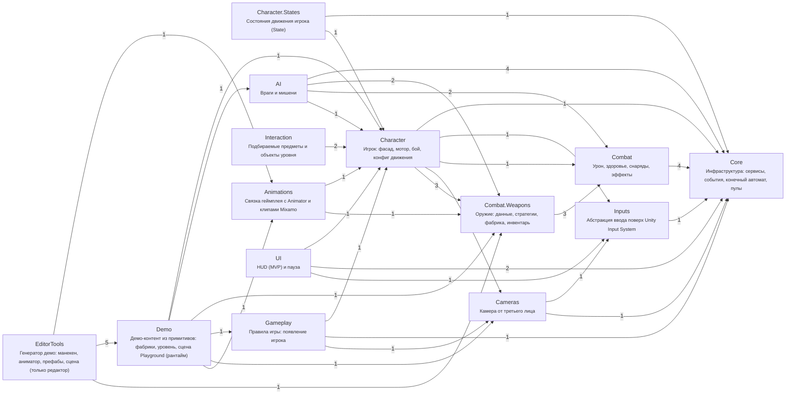

## Core — `Game.Core`

Инфраструктура: сервисы, события, конечный автомат, пулы.

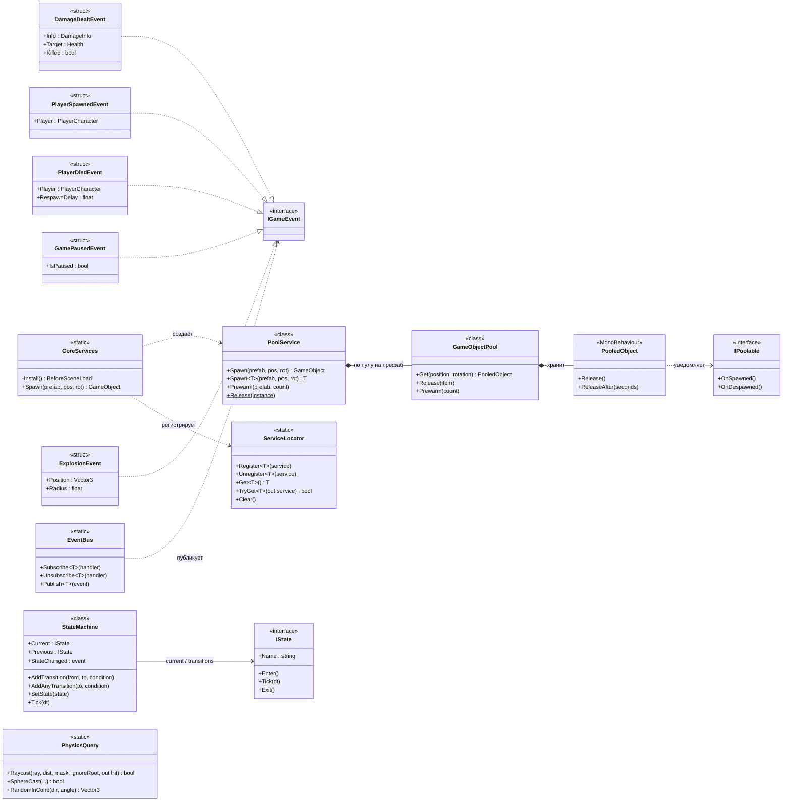

| Класс | Тип | Что делает |
|---|---|---|
| `ServiceLocator` | static | Регистрация и поиск глобальных сервисов по типу (обычно интерфейсу). **[Service Locator]** |
| `EventBus` | static | Глобальная типизированная шина событий: издатель не знает подписчиков. **[Observer]** |
| `IGameEvent` | interface | Маркер событий для EventBus. |
| `DamageDealtEvent` | struct | Кто-то получил урон (для хит-маркера, статистики). |
| `PlayerSpawnedEvent` | struct | Игрок появился/возродился. |
| `PlayerDiedEvent` | struct | Игрок погиб, возрождение через RespawnDelay. |
| `GamePausedEvent` | struct | Пауза включена/выключена. |
| `ExplosionEvent` | struct | Взрыв (для тряски камеры, звука). |
| `IState` | interface | Состояние конечного автомата. |
| `StateMachine` | class | Универсальный конечный автомат с таблицей переходов-условий. Используется игроком и ИИ. **[State]** |
| `IPoolable` | interface | Уведомления о выдаче/возврате объекта в пул. |
| `GameObjectPool` | class | Пул экземпляров одного префаба (Stack неактивных объектов). **[Object Pool]** |
| `PooledObject` | MonoBehaviour | Ссылка экземпляра на свой пул; возврат в пул сразу или по таймеру. |
| `PoolService` | class | Пулы по префабам. Глобальный сервис, живёт между сценами. |
| `CoreServices` | static | Composition Root: до загрузки сцены создаёт и регистрирует глобальные сервисы. **[Composition Root]** |
| `PhysicsQuery` | static | Рейкасты/сферокасты, игнорирующие коллайдеры владельца; разброс в конусе. |

## Inputs — `Game.Inputs`

Абстракция ввода поверх Unity Input System.

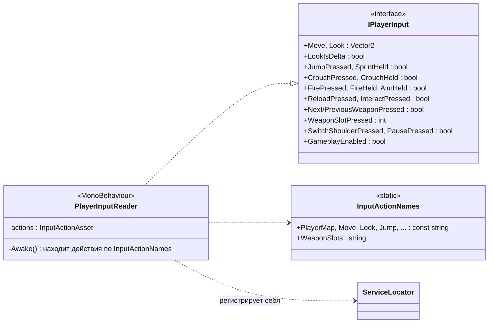

| Класс | Тип | Что делает |
|---|---|---|
| `IPlayerInput` | interface | Абстракция ввода: персонаж, камера и оружие не зависят от Input System. |
| `PlayerInputReader` | MonoBehaviour | Адаптер Unity Input System (InputActionAsset) к IPlayerInput. **[Adapter]** |
| `InputActionNames` | static | Имена карты и действий из InputSystem_Actions — единственное место со строками. |

## Character — `Game.Character`

Игрок: фасад, мотор, бой, конфиг движения.

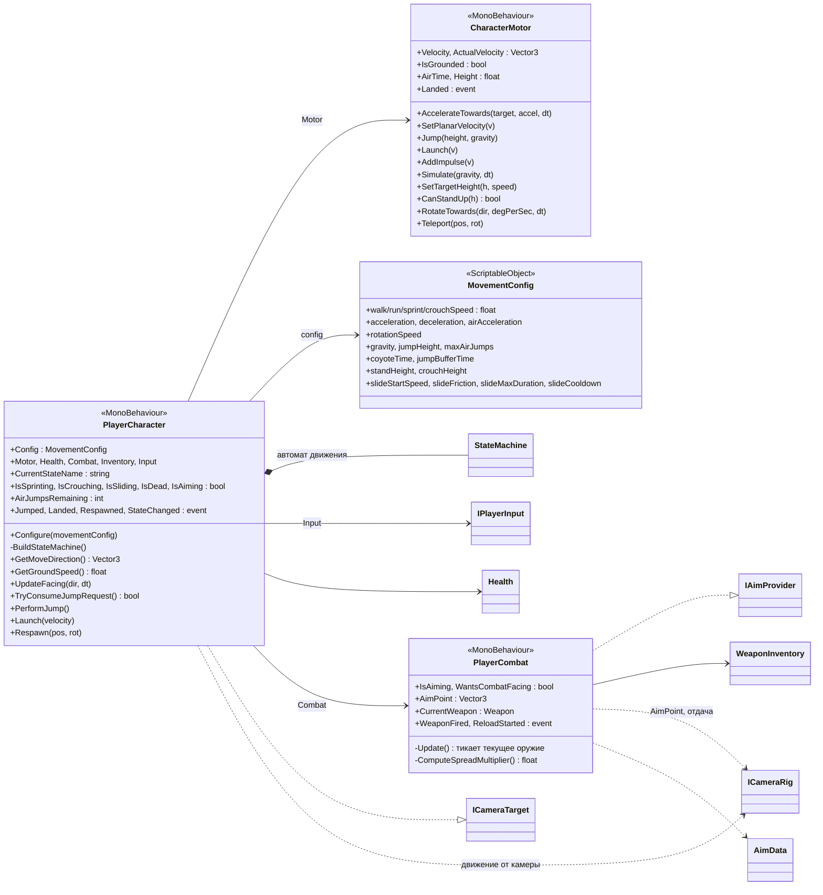

| Класс | Тип | Что делает |
|---|---|---|
| `MovementConfig` | ScriptableObject | Настройки передвижения: скорости, прыжок, присед, подкат. **[Data-driven config]** |
| `CharacterMotor` | MonoBehaviour | Перемещение поверх CharacterController: скорость, гравитация, прыжок, рост капсулы. |
| `PlayerCharacter` | MonoBehaviour | Фасад игрока: объединяет мотор, здоровье, бой, ввод; владеет автоматом состояний. **[Facade]** |
| `PlayerCombat` | MonoBehaviour | Прицеливание, стрельба, перезарядка, смена оружия, отдача камеры. |

## Character.States — `Game.Character.States`

Состояния движения игрока (State).

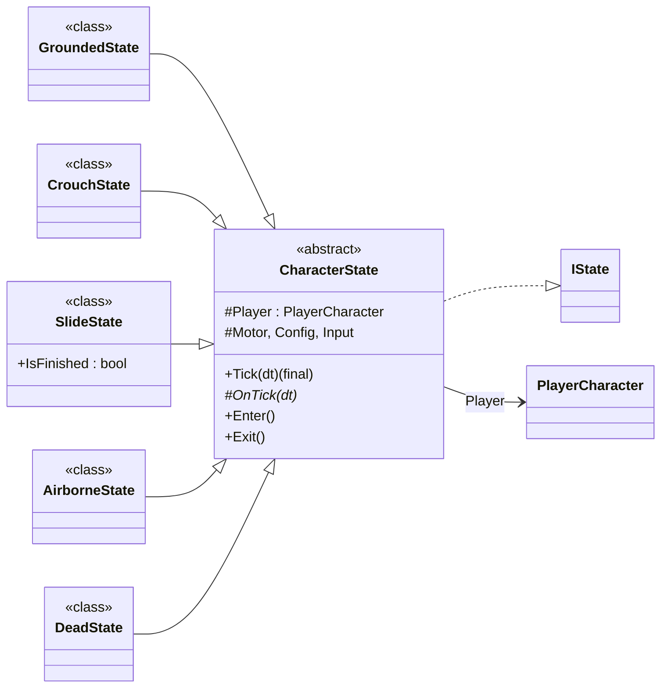

| Класс | Тип | Что делает |
|---|---|---|
| `CharacterState` | abstract | База состояний: Tick() = OnTick() + Motor.Simulate(). **[Template Method]** |
| `GroundedState` | class | На земле: стоим, идём при прицеливании, бежим, спринтуем. |
| `CrouchState` | class | Присед: низкая капсула, медленное движение. |
| `SlideState` | class | Подкат: рывок с затуханием скорости и низкой капсулой. |
| `AirborneState` | class | Прыжок/падение, двойной прыжок, управление в воздухе. |
| `DeadState` | class | Смерть: персонаж останавливается, ввод игнорируется. |

## Cameras — `Game.Cameras`

Камера от третьего лица.

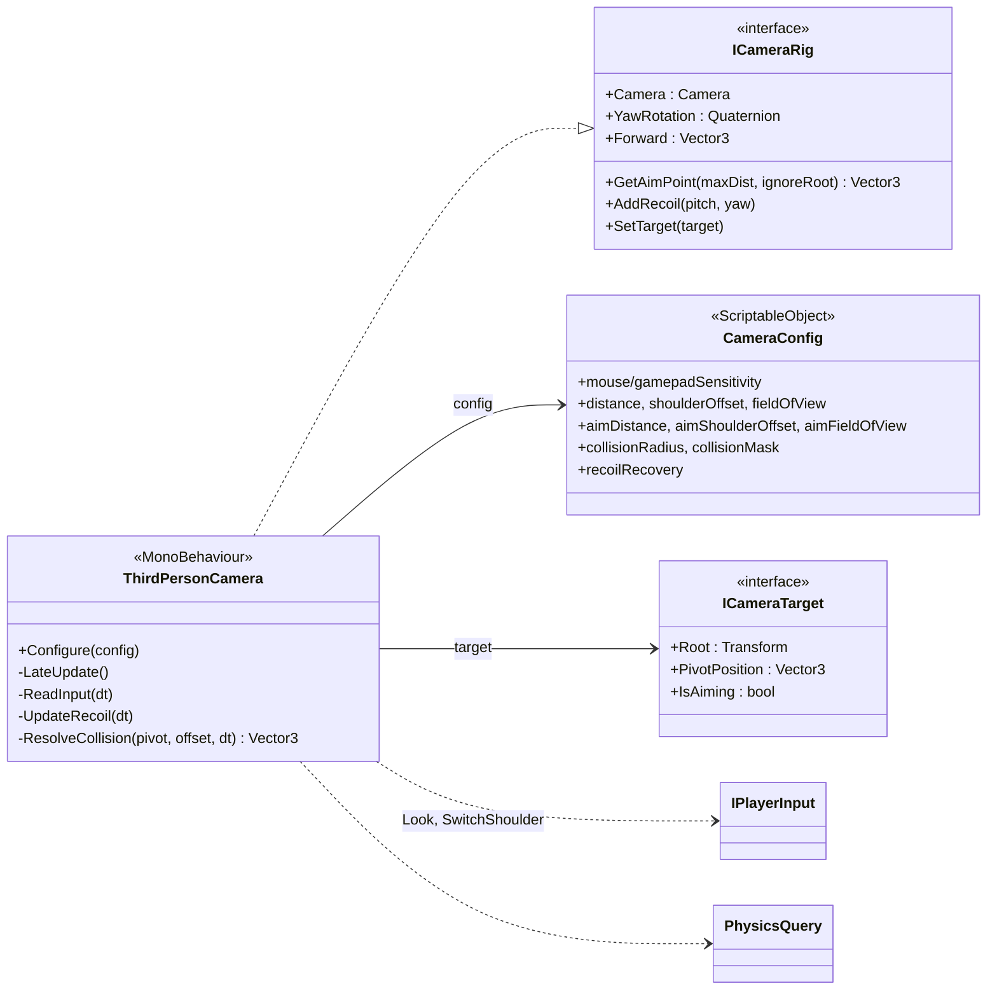

| Класс | Тип | Что делает |
|---|---|---|
| `ICameraTarget` | interface | То, за чем следует камера. |
| `ICameraRig` | interface | Сервис камеры для геймплея. |
| `CameraConfig` | ScriptableObject | Чувствительность, дистанции, плечо, FOV, коллизии, отдача. |
| `ThirdPersonCamera` | MonoBehaviour | Камера через плечо: орбита, прицел-зум, смена плеча, отдача, коллизии. |

## Animations — `Game.Animations`

Связка геймплея с Animator и клипами Mixamo.

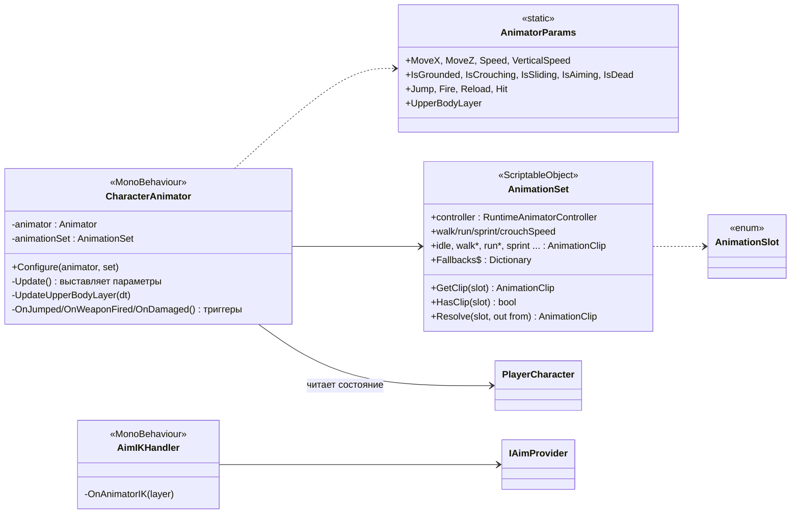

| Класс | Тип | Что делает |
|---|---|---|
| `AnimatorParams` | static | Имена/хэши параметров и слоёв Animator — общие для генератора и рантайма. |
| `AnimationSlot` | enum | Слоты анимаций: Idle, Walk*, Run*, Sprint, Crouch*, Slide, JumpStart, Fall, Death, AimIdle, Fire, Reload, HitReact. |
| `AnimationSet` | ScriptableObject | Набор клипов Mixamo + ссылка на сгенерированный контроллер. Пустые слоты берут запасной клип. |
| `CharacterAnimator` | MonoBehaviour | Переводит состояние игрока и его события в параметры Animator; запасные процедурные позы. **[Adapter]** |
| `AimIKHandler` | MonoBehaviour | Humanoid IK взгляда: голова и корпус смотрят в точку прицела. |

## Combat — `Game.Combat`

Урон, здоровье, снаряды, эффекты.

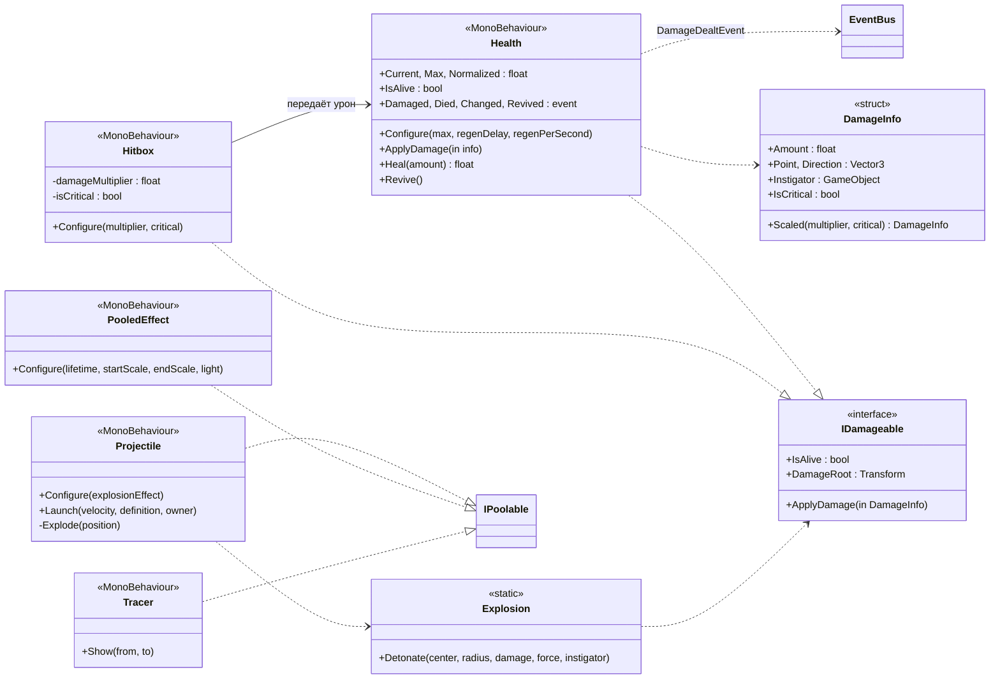

| Класс | Тип | Что делает |
|---|---|---|
| `DamageInfo` | struct | Описание попадания. |
| `IDamageable` | interface | Всё, что можно повредить. |
| `Health` | MonoBehaviour | Здоровье с событиями и регенерацией; публикует DamageDealtEvent. **[Observer]** |
| `Hitbox` | MonoBehaviour | Хитбокс (голова ×2): умножает урон и передаёт его в Health родителя. **[Proxy]** |
| `Projectile` | MonoBehaviour | Снаряд из пула: летит по дуге, проверяет попадание лучом, взрывается. |
| `Explosion` | static | Урон по площади с затуханием и толчок физики. |
| `PooledEffect` | MonoBehaviour | Простой эффект из пула: масштаб и свет по времени жизни. |
| `Tracer` | MonoBehaviour | Трассер пули на LineRenderer. |

## Combat.Weapons — `Game.Combat.Weapons`

Оружие: данные, стратегии, фабрика, инвентарь.

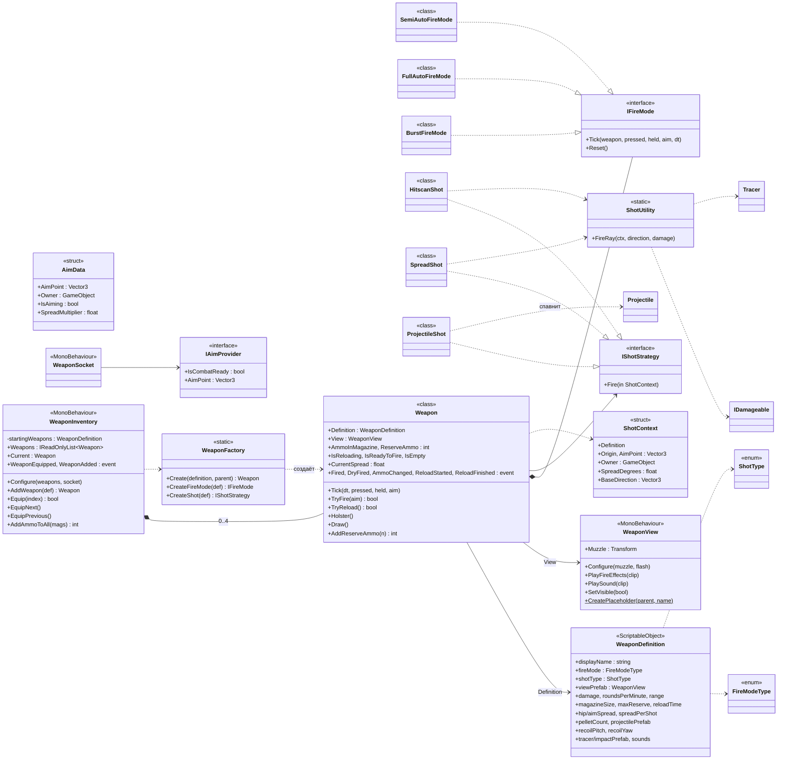

| Класс | Тип | Что делает |
|---|---|---|
| `FireModeType` | enum | SemiAuto, FullAuto, Burst |
| `ShotType` | enum | Hitscan, Spread, Projectile |
| `WeaponDefinition` | ScriptableObject | Данные оружия: урон, темп, патроны, разброс, отдача, эффекты. Новое оружие = новый ассет. **[Flyweight]** |
| `AimData` | struct | Куда стрелять в этом кадре. |
| `ShotContext` | struct | Контекст одного выстрела для стратегии. |
| `IFireMode` | interface | КОГДА стрелять. **[Strategy]** |
| `SemiAutoFireMode` | class | Выстрел на нажатие (с буфером нажатия). |
| `FullAutoFireMode` | class | Стрельба, пока зажат курок. |
| `BurstFireMode` | class | Очередь из N выстрелов на нажатие. |
| `IShotStrategy` | interface | ЧТО происходит при выстреле. **[Strategy]** |
| `HitscanShot` | class | Мгновенный луч. |
| `SpreadShot` | class | Дробь: несколько лучей. |
| `ProjectileShot` | class | Снаряд из пула. |
| `ShotUtility` | static | Общий код луча: урон, сила удара, искры, трассер. |
| `Weapon` | class | Экземпляр оружия: патроны, перезарядка, кулдаун, разброс. Поведение — в стратегиях. |
| `WeaponView` | MonoBehaviour | Визуал оружия: модель, дуло, вспышка, звук. |
| `WeaponFactory` | static | Собирает Weapon из WeaponDefinition: визуал + стратегии по enum-ам. **[Factory]** |
| `WeaponInventory` | MonoBehaviour | Слоты оружия: стартовое оружие, переключение, патроны. |
| `IAimProvider` | interface | Источник точки прицела для визуала. |
| `WeaponSocket` | MonoBehaviour | Крепление оружия: в бою ствол смотрит в прицел, вне боя — походное положение. |

## AI — `Game.AI`

Враги и мишени.

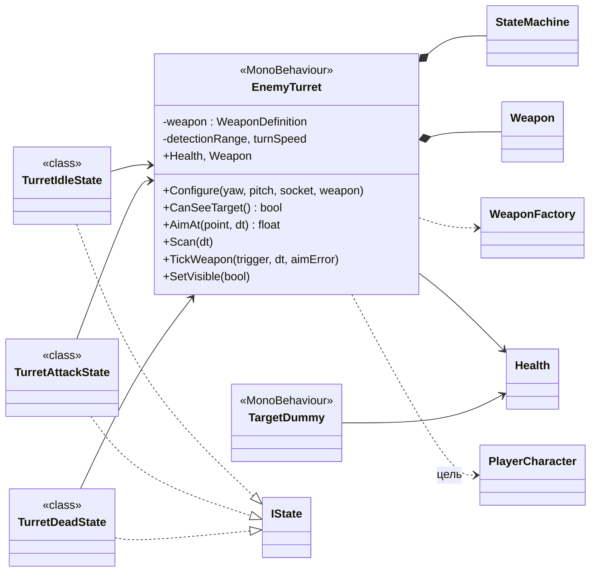

| Класс | Тип | Что делает |
|---|---|---|
| `EnemyTurret` | MonoBehaviour | Турель: ищет игрока, доворачивается и стреляет очередями. Переиспользует StateMachine и Weapon. |
| `TurretIdleState` | class | Нет цели — сканирование. |
| `TurretAttackState` | class | Цель видна — наведение и очереди. |
| `TurretDeadState` | class | Уничтожена — скрыта, затем восстанавливается. |
| `TargetDummy` | MonoBehaviour | Мишень: вспышка при попадании, исчезает и возрождается. |

## Interaction — `Game.Interaction`

Подбираемые предметы и объекты уровня.

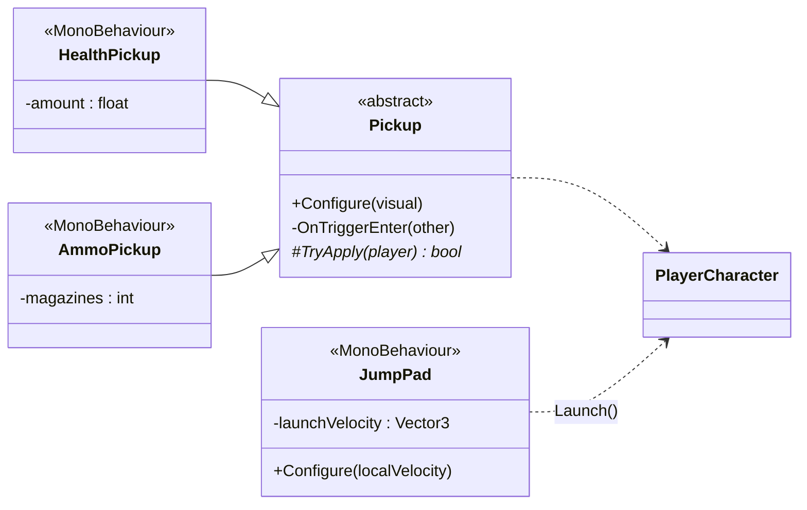

| Класс | Тип | Что делает |
|---|---|---|
| `Pickup` | abstract | Подбираемое: триггер → TryApply → скрыть → появиться снова. **[Template Method]** |
| `HealthPickup` | MonoBehaviour | Аптечка. |
| `AmmoPickup` | MonoBehaviour | Патроны всему оружию. |
| `JumpPad` | MonoBehaviour | Батут: подбрасывает игрока и восстанавливает прыжки. |

## Gameplay — `Game.Gameplay`

Правила игры: появление игрока.

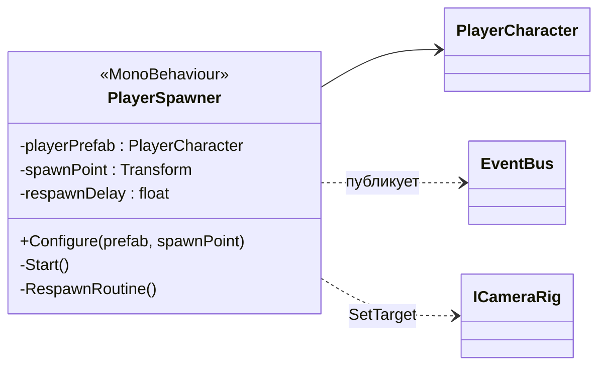

| Класс | Тип | Что делает |
|---|---|---|
| `PlayerSpawner` | MonoBehaviour | Появление и возрождение игрока, события PlayerSpawned/PlayerDied. |

## UI — `Game.UI`

HUD (MVP) и пауза.

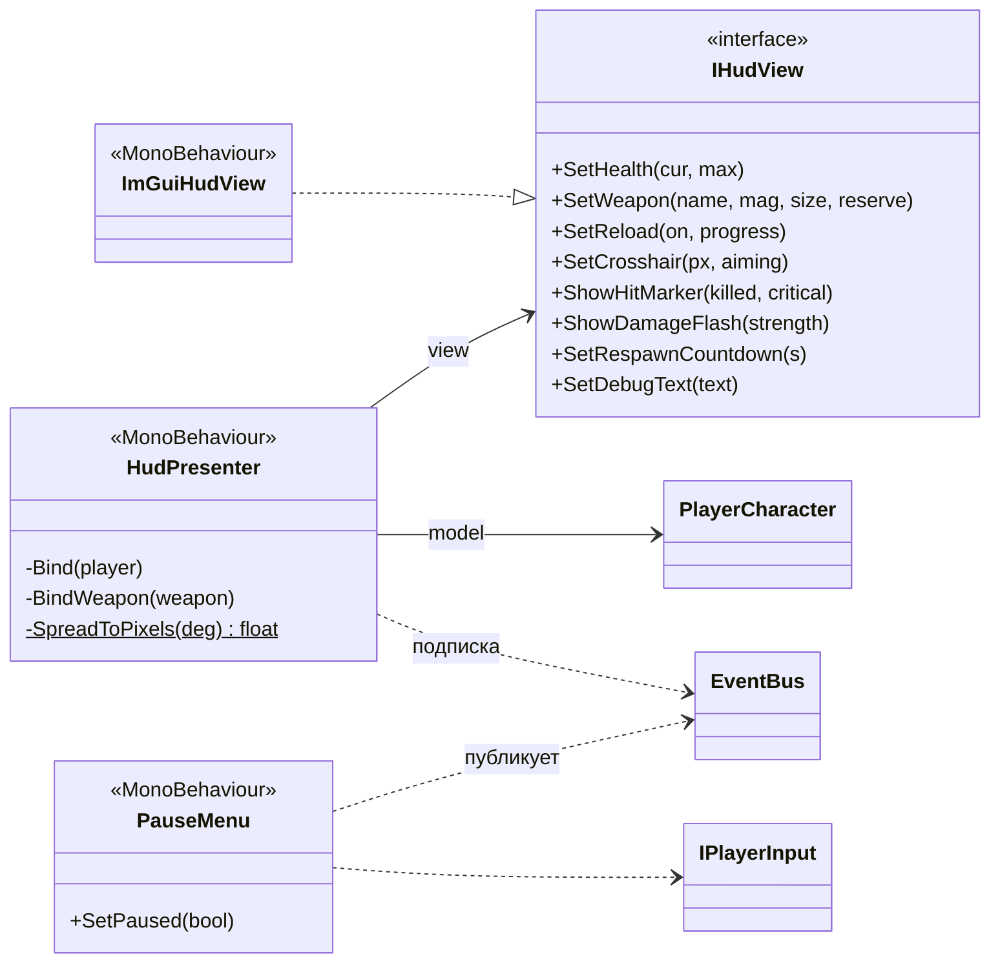

| Класс | Тип | Что делает |
|---|---|---|
| `IHudView` | interface | View (MVP): только отображение. |
| `HudPresenter` | MonoBehaviour | Presenter (MVP): слушает Health/Weapon/EventBus и обновляет IHudView. **[MVP]** |
| `ImGuiHudView` | MonoBehaviour | HUD на IMGUI: прицел, хит-маркер, HP, патроны, подсказки. |
| `PauseMenu` | MonoBehaviour | Пауза: timeScale, курсор, отключение ввода, GamePausedEvent. |

## Demo — `Game.Demo`

Демо-контент из примитивов: фабрики, уровень, сцена Playground (рантайм).

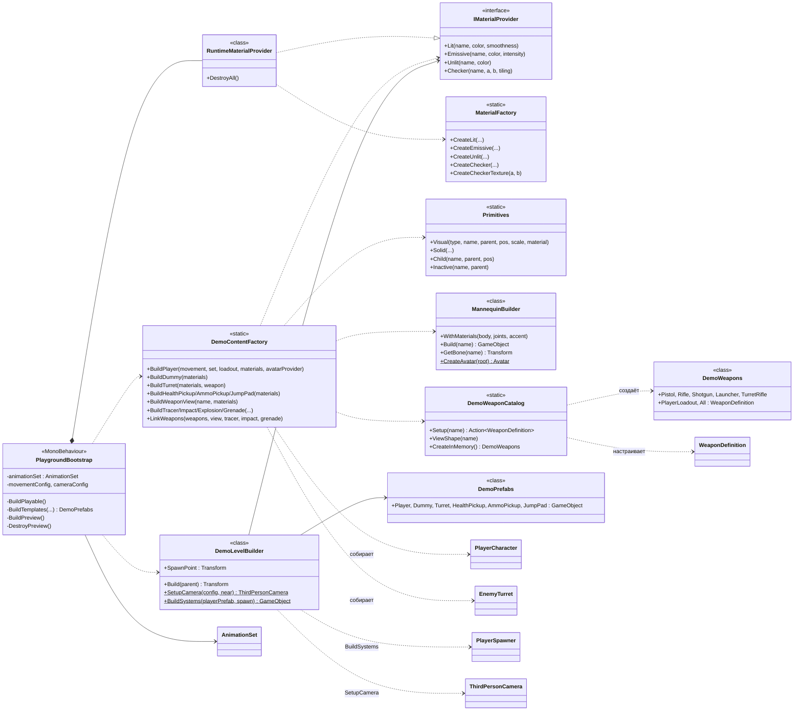

| Класс | Тип | Что делает |
|---|---|---|
| `IMaterialProvider` | interface | Источник материалов для примитивов: ассеты (редактор) или память (игра). **[Strategy]** |
| `MaterialFactory` | static | Создание материалов URP Lit/Unlit и текстуры-шахматки. |
| `RuntimeMaterialProvider` | class | Материалы в памяти с кэшем по имени (сцена Playground и её превью). |
| `Primitives` | static | Создание примитивов с коллайдером/без и неактивных объектов для настройки до Awake. |
| `MannequinBuilder` | class | Манекен из примитивов на скелете Mixamo (mixamorig:*) + Humanoid Avatar через AvatarBuilder. **[Builder]** |
| `DemoWeapons` | class | Набор демо-оружия. |
| `DemoWeaponCatalog` | static | Цифры баланса и размеры моделей демо-оружия — общие для генератора и Playground. |
| `DemoPrefabs` | class | Шаблоны для расстановки: префабы (редактор) или неактивные образцы (игра). |
| `DemoContentFactory` | static | Строит из примитивов игрока, мишень, турель, предметы, модели оружия и эффекты. **[Factory]** |
| `DemoLevelBuilder` | class | Строит полигон: тир, укрытия, тоннель, лестница, рампа, паркур, батут, турель, ящики; камера и системы сцены. **[Builder]** |
| `PlaygroundBootstrap` | MonoBehaviour | Сцена Playground из коробки: собирает полигон и игрока в игре; в редакторе — несохраняемое превью. **[Composition Root]** |

## EditorTools — `Game.EditorTools`

Генератор демо: манекен, аниматор, префабы, сцена (только редактор).

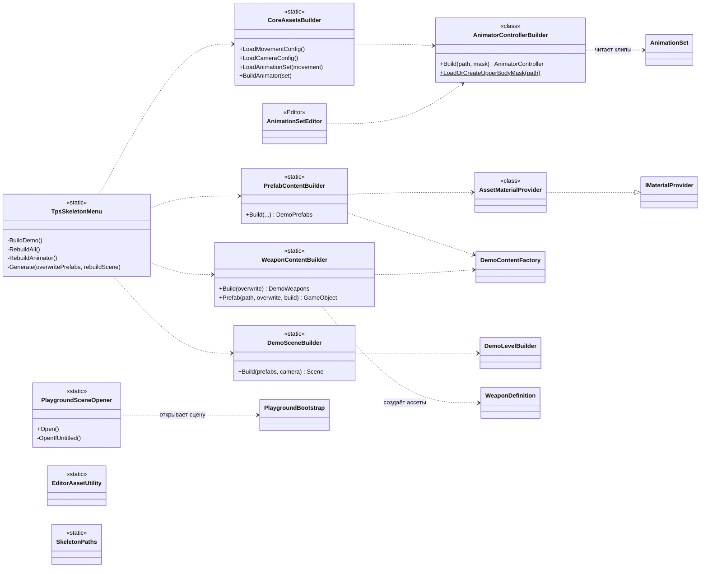

| Класс | Тип | Что делает |
|---|---|---|
| `TpsSkeletonMenu` | static | Меню Tools → TPS Skeleton: вся генерация одной кнопкой. **[Facade]** |
| `CoreAssetsBuilder` | static | Конфиги, AnimationSet (с клипами из Assets/Models), Animator Controller. |
| `AnimatorControllerBuilder` | class | Собирает Animator Controller из AnimationSet: blend trees, слои, переходы. **[Builder]** |
| `WeaponContentBuilder` | static | Сохраняет в ассеты эффекты, модели оружия и WeaponDefinition-ы из DemoContentFactory. |
| `PrefabContentBuilder` | static | Сохраняет в префабы игрока, мишень, турель, предметы; Avatar манекена — ассетом. |
| `DemoSceneBuilder` | static | Сцена Demo из префабов; раскладка — тот же DemoLevelBuilder. |
| `AnimationSetEditor` | Editor | Инспектор AnimationSet: подсказки, отчёт о заменах, кнопка Rebuild. |
| `AssetMaterialProvider` | class | IMaterialProvider для генератора: материалы сохраняются ассетами .mat. |
| `PlaygroundSceneOpener` | static | При старте редактора открывает сцену Playground вместо пустой безымянной; меню Open Playground Scene. |
| `EditorAssetUtility` | static | Папки, ScriptableObject, префабы, примитивы. |
| `SkeletonPaths` | static | Пути генерируемых ассетов (Assets/Game/Generated). |
