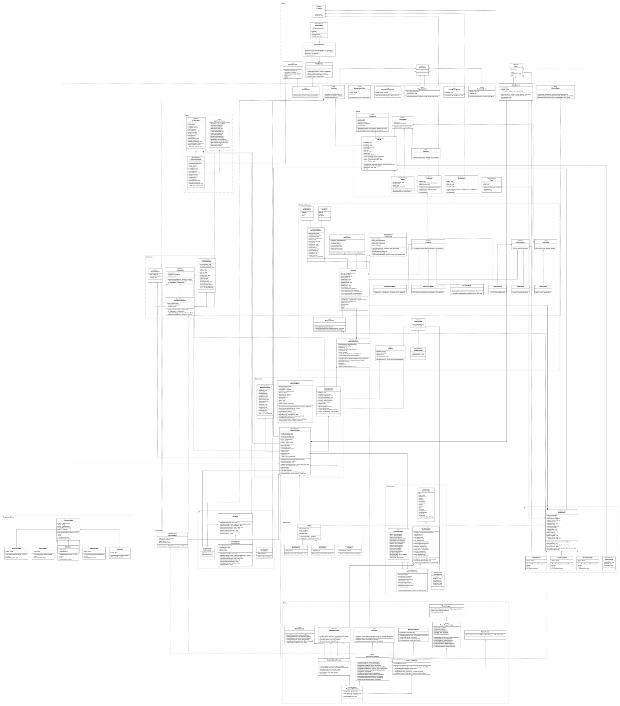
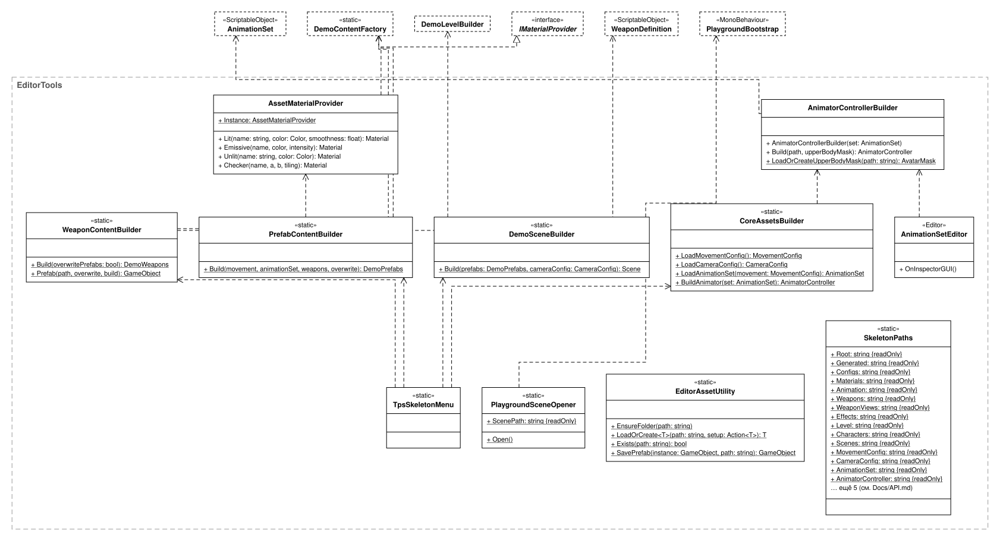
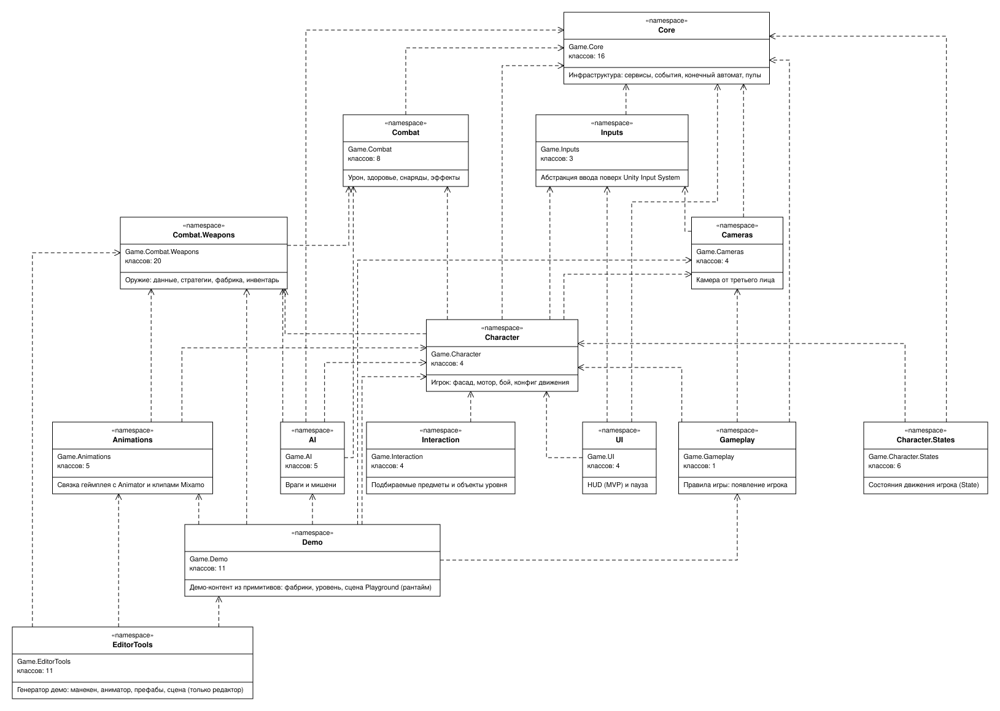

# UML-диаграммы классов

> Сгенерировано `Docs/tools/generate_uml.py`: члены классов берутся из кода, связи и описания — из `Docs/tools/uml_model.py`. Не правьте вручную. Полное описание каждого члена — в [API.md](API.md), устройство системы — в [ARCHITECTURE.md](ARCHITECTURE.md).

Файлы `*.drawio.svg` — это одновременно картинка (открывается в браузере/на GitHub) и редактируемая диаграмма draw.io. Все страницы вместе — в `Prod/Prod_di.drawio`.

## Нотация

| Обозначение | Значение |
|---|---|
| `+` `-` `#` `~` | public, private, protected, internal |
| подчёркнуто | статический член |
| *курсив* | абстрактный класс / метод, интерфейс |
| `- поле` у MonoBehaviour/ScriptableObject | приватное поле `[SerializeField]` (настраивается в инспекторе) |
| сплошная линия, пустой треугольник | наследование |
| пунктир, пустой треугольник | реализация интерфейса |
| линия с чёрным ромбом у владельца | композиция (владеет, создаёт) |
| сплошная линия, открытая стрелка | ассоциация (хранит ссылку) |
| пунктир, открытая стрелка | зависимость (использует, создаёт, публикует) |
| пунктирный блок без членов | класс из другого пакета/диаграммы |
| пунктирная рамка | пакет (namespace) |

## Классы игры

## Редактор (генератор демо)

## Пакеты

## Классы

| Класс | Пакет | Вид | Паттерн | Назначение |
|---|---|---|---|---|
| [`ServiceLocator`](API.md#servicelocator) | Core | static | Service Locator | Регистрация и поиск глобальных сервисов по типу (обычно интерфейсу). |
| [`EventBus`](API.md#eventbus) | Core | static | Observer | Глобальная типизированная шина событий: издатель не знает подписчиков. |
| [`IGameEvent`](API.md#igameevent) | Core | interface |  | Маркер событий для EventBus. |
| [`DamageDealtEvent`](API.md#damagedealtevent) | Core | struct |  | Кто-то получил урон (для хит-маркера, статистики). |
| [`PlayerSpawnedEvent`](API.md#playerspawnedevent) | Core | struct |  | Игрок появился/возродился. |
| [`PlayerDiedEvent`](API.md#playerdiedevent) | Core | struct |  | Игрок погиб, возрождение через RespawnDelay. |
| [`GamePausedEvent`](API.md#gamepausedevent) | Core | struct |  | Пауза включена/выключена. |
| [`ExplosionEvent`](API.md#explosionevent) | Core | struct |  | Взрыв (для тряски камеры, звука). |
| [`IState`](API.md#istate) | Core | interface |  | Состояние конечного автомата. |
| [`StateMachine`](API.md#statemachine) | Core | class | State | Универсальный конечный автомат с таблицей переходов-условий. Используется игроком и ИИ. |
| [`IPoolable`](API.md#ipoolable) | Core | interface |  | Уведомления о выдаче/возврате объекта в пул. |
| [`GameObjectPool`](API.md#gameobjectpool) | Core | class | Object Pool | Пул экземпляров одного префаба (Stack неактивных объектов). |
| [`PooledObject`](API.md#pooledobject) | Core | MonoBehaviour |  | Ссылка экземпляра на свой пул; возврат в пул сразу или по таймеру. |
| [`PoolService`](API.md#poolservice) | Core | class |  | Пулы по префабам. Глобальный сервис, живёт между сценами. |
| [`CoreServices`](API.md#coreservices) | Core | static | Composition Root | Composition Root: до загрузки сцены создаёт и регистрирует глобальные сервисы. |
| [`PhysicsQuery`](API.md#physicsquery) | Core | static |  | Рейкасты/сферокасты, игнорирующие коллайдеры владельца; разброс в конусе. |
| [`IPlayerInput`](API.md#iplayerinput) | Inputs | interface |  | Абстракция ввода: персонаж, камера и оружие не зависят от Input System. |
| [`PlayerInputReader`](API.md#playerinputreader) | Inputs | MonoBehaviour | Adapter | Адаптер Unity Input System (InputActionAsset) к IPlayerInput. |
| [`InputActionNames`](API.md#inputactionnames) | Inputs | static |  | Имена карты и действий из InputSystem_Actions — единственное место со строками. |
| [`MovementConfig`](API.md#movementconfig) | Character | ScriptableObject | Data-driven config | Настройки передвижения: скорости, прыжок, присед, подкат. |
| [`CharacterMotor`](API.md#charactermotor) | Character | MonoBehaviour |  | Перемещение поверх CharacterController: скорость, гравитация, прыжок, рост капсулы. |
| [`PlayerCharacter`](API.md#playercharacter) | Character | MonoBehaviour | Facade | Фасад игрока: объединяет мотор, здоровье, бой, ввод; владеет автоматом состояний. |
| [`PlayerCombat`](API.md#playercombat) | Character | MonoBehaviour |  | Прицеливание, стрельба, перезарядка, смена оружия, отдача камеры. |
| [`CharacterState`](API.md#characterstate) | Character.States | abstract | Template Method | База состояний: Tick() = OnTick() + Motor.Simulate(). |
| [`GroundedState`](API.md#groundedstate) | Character.States | class |  | На земле: стоим, идём при прицеливании, бежим, спринтуем. |
| [`CrouchState`](API.md#crouchstate) | Character.States | class |  | Присед: низкая капсула, медленное движение. |
| [`SlideState`](API.md#slidestate) | Character.States | class |  | Подкат: рывок с затуханием скорости и низкой капсулой. |
| [`AirborneState`](API.md#airbornestate) | Character.States | class |  | Прыжок/падение, двойной прыжок, управление в воздухе. |
| [`DeadState`](API.md#deadstate) | Character.States | class |  | Смерть: персонаж останавливается, ввод игнорируется. |
| [`ICameraTarget`](API.md#icameratarget) | Cameras | interface |  | То, за чем следует камера. |
| [`ICameraRig`](API.md#icamerarig) | Cameras | interface |  | Сервис камеры для геймплея. |
| [`CameraConfig`](API.md#cameraconfig) | Cameras | ScriptableObject |  | Чувствительность, дистанции, плечо, FOV, коллизии, отдача. |
| [`ThirdPersonCamera`](API.md#thirdpersoncamera) | Cameras | MonoBehaviour |  | Камера через плечо: орбита, прицел-зум, смена плеча, отдача, коллизии. |
| [`AnimatorParams`](API.md#animatorparams) | Animations | static |  | Имена/хэши параметров и слоёв Animator — общие для генератора и рантайма. |
| [`AnimationSlot`](API.md#animationslot) | Animations | enum |  | Слоты анимаций: Idle, Walk*, Run*, Sprint, Crouch*, Slide, JumpStart, Fall, Death, AimIdle, Fire, Reload, HitReact. |
| [`AnimationSet`](API.md#animationset) | Animations | ScriptableObject |  | Набор клипов Mixamo + ссылка на сгенерированный контроллер. Пустые слоты берут запасной клип. |
| [`CharacterAnimator`](API.md#characteranimator) | Animations | MonoBehaviour | Adapter | Переводит состояние игрока и его события в параметры Animator; запасные процедурные позы. |
| [`AimIKHandler`](API.md#aimikhandler) | Animations | MonoBehaviour |  | Humanoid IK взгляда: голова и корпус смотрят в точку прицела. |
| [`DamageInfo`](API.md#damageinfo) | Combat | struct |  | Описание попадания. |
| [`IDamageable`](API.md#idamageable) | Combat | interface |  | Всё, что можно повредить. |
| [`Health`](API.md#health) | Combat | MonoBehaviour | Observer | Здоровье с событиями и регенерацией; публикует DamageDealtEvent. |
| [`Hitbox`](API.md#hitbox) | Combat | MonoBehaviour | Proxy | Хитбокс (голова ×2): умножает урон и передаёт его в Health родителя. |
| [`Projectile`](API.md#projectile) | Combat | MonoBehaviour |  | Снаряд из пула: летит по дуге, проверяет попадание лучом, взрывается. |
| [`Explosion`](API.md#explosion) | Combat | static |  | Урон по площади с затуханием и толчок физики. |
| [`PooledEffect`](API.md#pooledeffect) | Combat | MonoBehaviour |  | Простой эффект из пула: масштаб и свет по времени жизни. |
| [`Tracer`](API.md#tracer) | Combat | MonoBehaviour |  | Трассер пули на LineRenderer. |
| [`FireModeType`](API.md#firemodetype) | Combat.Weapons | enum |  | SemiAuto, FullAuto, Burst |
| [`ShotType`](API.md#shottype) | Combat.Weapons | enum |  | Hitscan, Spread, Projectile |
| [`WeaponDefinition`](API.md#weapondefinition) | Combat.Weapons | ScriptableObject | Flyweight | Данные оружия: урон, темп, патроны, разброс, отдача, эффекты. Новое оружие = новый ассет. |
| [`AimData`](API.md#aimdata) | Combat.Weapons | struct |  | Куда стрелять в этом кадре. |
| [`ShotContext`](API.md#shotcontext) | Combat.Weapons | struct |  | Контекст одного выстрела для стратегии. |
| [`IFireMode`](API.md#ifiremode) | Combat.Weapons | interface | Strategy | КОГДА стрелять. |
| [`SemiAutoFireMode`](API.md#semiautofiremode) | Combat.Weapons | class |  | Выстрел на нажатие (с буфером нажатия). |
| [`FullAutoFireMode`](API.md#fullautofiremode) | Combat.Weapons | class |  | Стрельба, пока зажат курок. |
| [`BurstFireMode`](API.md#burstfiremode) | Combat.Weapons | class |  | Очередь из N выстрелов на нажатие. |
| [`IShotStrategy`](API.md#ishotstrategy) | Combat.Weapons | interface | Strategy | ЧТО происходит при выстреле. |
| [`HitscanShot`](API.md#hitscanshot) | Combat.Weapons | class |  | Мгновенный луч. |
| [`SpreadShot`](API.md#spreadshot) | Combat.Weapons | class |  | Дробь: несколько лучей. |
| [`ProjectileShot`](API.md#projectileshot) | Combat.Weapons | class |  | Снаряд из пула. |
| [`ShotUtility`](API.md#shotutility) | Combat.Weapons | static |  | Общий код луча: урон, сила удара, искры, трассер. |
| [`Weapon`](API.md#weapon) | Combat.Weapons | class |  | Экземпляр оружия: патроны, перезарядка, кулдаун, разброс. Поведение — в стратегиях. |
| [`WeaponView`](API.md#weaponview) | Combat.Weapons | MonoBehaviour |  | Визуал оружия: модель, дуло, вспышка, звук. |
| [`WeaponFactory`](API.md#weaponfactory) | Combat.Weapons | static | Factory | Собирает Weapon из WeaponDefinition: визуал + стратегии по enum-ам. |
| [`WeaponInventory`](API.md#weaponinventory) | Combat.Weapons | MonoBehaviour |  | Слоты оружия: стартовое оружие, переключение, патроны. |
| [`IAimProvider`](API.md#iaimprovider) | Combat.Weapons | interface |  | Источник точки прицела для визуала. |
| [`WeaponSocket`](API.md#weaponsocket) | Combat.Weapons | MonoBehaviour |  | Крепление оружия: в бою ствол смотрит в прицел, вне боя — походное положение. |
| [`EnemyTurret`](API.md#enemyturret) | AI | MonoBehaviour |  | Турель: ищет игрока, доворачивается и стреляет очередями. Переиспользует StateMachine и Weapon. |
| [`TurretIdleState`](API.md#turretidlestate) | AI | class |  | Нет цели — сканирование. |
| [`TurretAttackState`](API.md#turretattackstate) | AI | class |  | Цель видна — наведение и очереди. |
| [`TurretDeadState`](API.md#turretdeadstate) | AI | class |  | Уничтожена — скрыта, затем восстанавливается. |
| [`TargetDummy`](API.md#targetdummy) | AI | MonoBehaviour |  | Мишень: вспышка при попадании, исчезает и возрождается. |
| [`Pickup`](API.md#pickup) | Interaction | abstract | Template Method | Подбираемое: триггер → TryApply → скрыть → появиться снова. |
| [`HealthPickup`](API.md#healthpickup) | Interaction | MonoBehaviour |  | Аптечка. |
| [`AmmoPickup`](API.md#ammopickup) | Interaction | MonoBehaviour |  | Патроны всему оружию. |
| [`JumpPad`](API.md#jumppad) | Interaction | MonoBehaviour |  | Батут: подбрасывает игрока и восстанавливает прыжки. |
| [`PlayerSpawner`](API.md#playerspawner) | Gameplay | MonoBehaviour |  | Появление и возрождение игрока, события PlayerSpawned/PlayerDied. |
| [`IHudView`](API.md#ihudview) | UI | interface |  | View (MVP): только отображение. |
| [`HudPresenter`](API.md#hudpresenter) | UI | MonoBehaviour | MVP | Presenter (MVP): слушает Health/Weapon/EventBus и обновляет IHudView. |
| [`ImGuiHudView`](API.md#imguihudview) | UI | MonoBehaviour |  | HUD на IMGUI: прицел, хит-маркер, HP, патроны, подсказки. |
| [`PauseMenu`](API.md#pausemenu) | UI | MonoBehaviour |  | Пауза: timeScale, курсор, отключение ввода, GamePausedEvent. |
| [`IMaterialProvider`](API.md#imaterialprovider) | Demo | interface | Strategy | Источник материалов для примитивов: ассеты (редактор) или память (игра). |
| [`MaterialFactory`](API.md#materialfactory) | Demo | static |  | Создание материалов URP Lit/Unlit и текстуры-шахматки. |
| [`RuntimeMaterialProvider`](API.md#runtimematerialprovider) | Demo | class |  | Материалы в памяти с кэшем по имени (сцена Playground и её превью). |
| [`Primitives`](API.md#primitives) | Demo | static |  | Создание примитивов с коллайдером/без и неактивных объектов для настройки до Awake. |
| [`MannequinBuilder`](API.md#mannequinbuilder) | Demo | class | Builder | Манекен из примитивов на скелете Mixamo (mixamorig:*) + Humanoid Avatar через AvatarBuilder. |
| [`DemoWeapons`](API.md#demoweapons) | Demo | class |  | Набор демо-оружия. |
| [`DemoWeaponCatalog`](API.md#demoweaponcatalog) | Demo | static |  | Цифры баланса и размеры моделей демо-оружия — общие для генератора и Playground. |
| [`DemoPrefabs`](API.md#demoprefabs) | Demo | class |  | Шаблоны для расстановки: префабы (редактор) или неактивные образцы (игра). |
| [`DemoContentFactory`](API.md#democontentfactory) | Demo | static | Factory | Строит из примитивов игрока, мишень, турель, предметы, модели оружия и эффекты. |
| [`DemoLevelBuilder`](API.md#demolevelbuilder) | Demo | class | Builder | Строит полигон: тир, укрытия, тоннель, лестница, рампа, паркур, батут, турель, ящики; камера и системы сцены. |
| [`PlaygroundBootstrap`](API.md#playgroundbootstrap) | Demo | MonoBehaviour | Composition Root | Сцена Playground из коробки: собирает полигон и игрока в игре; в редакторе — несохраняемое превью. |
| [`TpsSkeletonMenu`](API.md#tpsskeletonmenu) | EditorTools | static | Facade | Меню Tools → TPS Skeleton: вся генерация одной кнопкой. |
| [`CoreAssetsBuilder`](API.md#coreassetsbuilder) | EditorTools | static |  | Конфиги, AnimationSet (с клипами из Assets/Models), Animator Controller. |
| [`AnimatorControllerBuilder`](API.md#animatorcontrollerbuilder) | EditorTools | class | Builder | Собирает Animator Controller из AnimationSet: blend trees, слои, переходы. |
| [`WeaponContentBuilder`](API.md#weaponcontentbuilder) | EditorTools | static |  | Сохраняет в ассеты эффекты, модели оружия и WeaponDefinition-ы из DemoContentFactory. |
| [`PrefabContentBuilder`](API.md#prefabcontentbuilder) | EditorTools | static |  | Сохраняет в префабы игрока, мишень, турель, предметы; Avatar манекена — ассетом. |
| [`DemoSceneBuilder`](API.md#demoscenebuilder) | EditorTools | static |  | Сцена Demo из префабов; раскладка — тот же DemoLevelBuilder. |
| [`AnimationSetEditor`](API.md#animationseteditor) | EditorTools | Editor |  | Инспектор AnimationSet: подсказки, отчёт о заменах, кнопка Rebuild. |
| [`AssetMaterialProvider`](API.md#assetmaterialprovider) | EditorTools | class |  | IMaterialProvider для генератора: материалы сохраняются ассетами .mat. |
| [`PlaygroundSceneOpener`](API.md#playgroundsceneopener) | EditorTools | static |  | При старте редактора открывает сцену Playground вместо пустой безымянной; меню Open Playground Scene. |
| [`EditorAssetUtility`](API.md#editorassetutility) | EditorTools | static |  | Папки, ScriptableObject, префабы, примитивы. |
| [`SkeletonPaths`](API.md#skeletonpaths) | EditorTools | static |  | Пути генерируемых ассетов (Assets/Game/Generated). |
